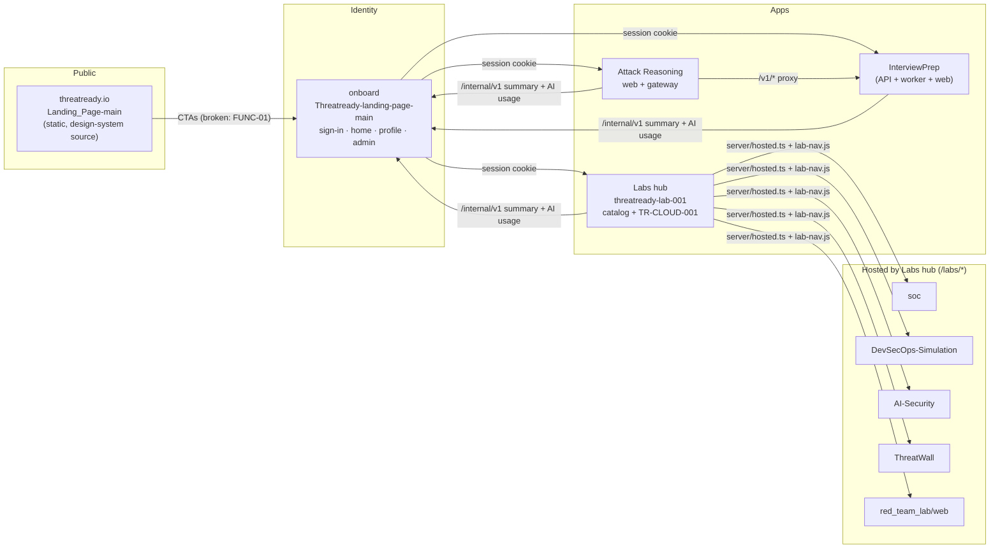
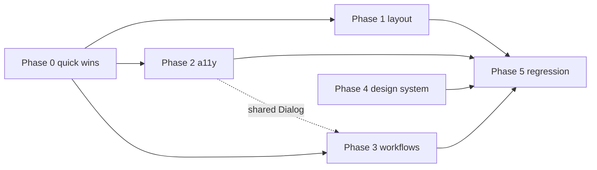

# ThreatReady: Comprehensive UI/UX Audit

| | |
|---|---|
| **Repository** | `Ricky-Hacker001/Threat_Ready`, branch `main`, commit `93cc4bf` |
| **Audit date** | 23 October 2026 |
| **Type** | Audit only. No application source, styles, configuration or dependencies were changed. This document and the screenshots in `audit/docs/audit-evidence/` are the only additions to the repository. |
| **Covers** | UI/UX, overflow, usability and cognitive load, learning and simulation workflows, responsive layout, accessibility, functional UI, visual consistency, browser console, and a prioritised fix plan |
| **Status** | **Fixes applied** on local branch `ui-ux-audit-fixes` (not committed, not pushed). 86 of 96 findings are fixed, 6 are partly fixed and 4 are left open on purpose. See [§17 Fix status](#17-fix-status-23-oct-2026). Sections 1–16 are the original audit, kept as the baseline. |

---

## Contents

1. [Executive summary](#1-executive-summary)
2. [Scope, method and limitations](#2-scope-method-and-limitations)
3. [Repository discovery and architecture](#3-repository-discovery-and-architecture)
4. [Route, page and feature inventory](#4-route-page-and-feature-inventory)
5. [Overall UI/UX audit](#5-overall-uiux-audit)
6. [Overflow and layout defects](#6-overflow-and-layout-defects)
7. [Usability and cognitive load](#7-usability-and-cognitive-load)
8. [Learning and simulation workflow review](#8-learning-and-simulation-workflow-review)
9. [Responsive testing](#9-responsive-testing)
10. [Accessibility](#10-accessibility)
11. [Functional UI validation](#11-functional-ui-validation)
12. [Browser, console and regression testing](#12-browser-console-and-regression-testing)
13. [Re-check of the 14 Oct 2026 UX audit](#13-re-check-of-the-14-oct-2026-ux-audit)
14. [Prioritised fix plan and acceptance criteria](#14-prioritised-fix-plan-and-acceptance-criteria)
15. [Open questions and product decisions](#15-open-questions-and-product-decisions)
16. [Appendix: evidence index and how to reproduce](#16-appendix-evidence-index-and-how-to-reproduce)
17. [Fix status (23 Oct 2026)](#17-fix-status-23-oct-2026)

---

## 1. Executive summary

### Verdict

ThreatReady's content is strong: realistic scenarios, honest "simulated environment" messaging, and feedback that explains why an answer was right or wrong. The SOC after-action review and the ThreatWall verification list are the best examples. The interface around that content is inconsistent, though. Ten apps have grown side by side, and each has its own conventions for layout, colour, keyboard support and saving progress.

Four groups of problems matter most:

1. **Broken or misleading journeys.**
   - The marketing site's sign-up and sign-in buttons point to a path that does not exist.
   - The Blue Team track says it has no labs, but the SOC lab is live.
   - The free trial promises usage that it then blocks.
   - In the AI Security Lab, an attempt that fails its re-test cannot be finished, and a page reload loses the attempt.
2. **Layout that breaks inside the platform.**
   - When a lab runs inside the platform, a thin bar (the lab-nav strip) is added to the top of the page. That bar changes how the page height is calculated.
   - In TR-CLOUD-001 at 1366×768, the console grows to 1,488 px tall and the action dock starts at y = 1,318, below the fold. *Confirmed in a browser.*
   - Ten pages scroll sideways on phones. *Confirmed in a browser.*
3. **Accessibility gaps on core tasks.**
   - Keyboard focus gets stuck in two places: the DevSecOps code editor and the Red Team terminal. *Confirmed.*
   - The Red Team lab has almost no accessibility markup (one ARIA attribute in the whole client).
   - The AI Security architecture map is scored, but it cannot be used with a keyboard.
   - The brand violet `#6D5DFC` is used as text on dark backgrounds at 3.9–4.2:1, below the 4.5:1 minimum, in at least five apps.
4. **No shared design system in practice.**
   - There are three button systems, two container widths and four different approaches to light theme. Four lab apps ignore the user's theme choice altogether.
   - Errors in InterviewPrep use the same violet as primary buttons.
   - The theme does not carry over between threatready.io and the signed-in apps.

### Numbers

| Measure | Result |
|---|---|
| Apps and modules found | 10 deployable front ends + 1 deployment gateway + 1 cross-browser e2e harness |
| Pages and states tested in a browser | 36 (×8 viewports = 288 layout checks), plus 5 multi-step workflows at 3 viewports |
| Layout checks that failed (horizontal page overflow) | **19 of 288**, across **10 pages/states** (plus 1 more found in a multi-step walkthrough: AI Security mission control) |
| Automated accessibility violations (axe-core, WCAG 2.1 A/AA + best practice) | 11 rule types; **241 colour-contrast nodes** across 16 of 36 pages |
| Findings in this report | **96** (Critical 3 · High 21 · Medium 43 · Low 29) |
| Apps blocked for runtime testing | 3: onboard, InterviewPrep, Attack Reasoning (they need PostgreSQL and LLM services, and Docker is not installed on this machine) |

### Top 12 issues to fix first

| # | ID | Severity | Issue | Evidence |
|---|---|---|---|---|
| 1 | FUNC-01 | Critical | About 74 marketing CTAs ("Sign in", "Start free") point to `threatready.io/app/…`, which does not exist | Source confirmed |
| 2 | FUNC-02 | Critical | When hosted, the SOC live log stream and downloads use absolute `/api/…` paths, so they miss the SOC app | Source confirmed; prior audit confirmed it in the built bundle |
| 3 | OVF-01 | Critical | The lab-nav strip forces `height:auto`. In the TR-CLOUD-001 console the dock drops below the fold and the panes stop scrolling on their own. ThreatWall and DevSecOps become 40 px taller than the screen | **Runtime confirmed** |
| 4 | UX-01 | High | The Blue Team track shows "No labs in this track yet" while the SOC lab is live | **Runtime confirmed** |
| 5 | FUNC-04 / FUNC-05 | High | AI Security Lab: a failed re-test cannot reach results; refresh, Back or Exit loses the attempt | Runtime confirmed (reload); source confirmed (finish) |
| 6 | A11Y-01 | High | Keyboard focus is trapped in the DevSecOps editor and the Red Team terminal | **Runtime confirmed** |
| 7 | A11Y-02 | High | Red Team lab: unlabelled inputs, mouse-only controls, modals that aren't marked as dialogs, toasts that screen readers never announce, and hidden drawers that keyboard focus can still reach | Source confirmed + runtime (drawers) |
| 8 | A11Y-05 | High | Violet `#6D5DFC` used as text on dark backgrounds fails 4.5:1 (SOC, DevSecOps, AI Security, onboard links, rubric page) | **axe, runtime confirmed** |
| 9 | VIS-01 | High | Attack Reasoning score-breakdown bars render nothing, because no CSS rule styles their markup | Source confirmed |
| 10 | FUNC-03 | High | Free trial promises "1 interview, 2 simulations and 1 reasoning session", but every product then says "Needs a free account" | Source confirmed |
| 11 | CONT-01 | High | Legal pages still contain the placeholders "[Registered Office Address]" and "[To be appointed]" | Source confirmed |
| 12 | UX-07 | High | InterviewPrep voice answers auto-submit after about 9.5 s of silence, and nothing announces the countdown | Source confirmed |

---

## 2. Scope, method and limitations

### 2.1 Evidence labels

Every finding carries one of these labels:

| Label | Meaning |
|---|---|
| **RC**: runtime confirmed | Reproduced in a real browser (Google Chrome, driven by `playwright-core` 1.53.2). Measurements come from DOM geometry or from axe-core 4.10.3. |
| **SC**: source confirmed | The code or CSS clearly produces the behaviour. Not observed in a browser, usually because the app could not run here. |
| **SI**: source-inferred risk | Likely from reading the code, but needs a browser check before anyone fixes it. |
| **PA**: prior audit | Taken from `docs/UX_AUDIT.md` (14 Oct) or `audit/docs/AUDIT_REPORT_2026-10-15.md` and re-checked against the current source. |

### 2.2 Severity scale

| Severity | Definition |
|---|---|
| **Critical** | Blocks a primary journey for most users, loses work or data, or makes a main screen unusable at a common size |
| **High** | A core task fails or is seriously degraded; a WCAG 2.1 A/AA failure on a core flow; a confirmed layout break at a supported viewport; misleading product state |
| **Medium** | Slows people down or causes confusion, but a workaround exists; a WCAG issue on a secondary flow; design-system drift that users can see |
| **Low** | Polish, consistency or wording |

### 2.3 What was done

1. **Repository discovery.** I read the root `README.md`, every app's README and docs, the package manifests, the routers, the shared CSS, `deploy/` and the e2e harness. I also read the two existing audits.
2. **Source review.** Five parallel read-only reviews covered every front end, with file:line evidence:
   - onboard + marketing site
   - InterviewPrep
   - Labs hub + Attack Reasoning
   - SOC + Red Team
   - ThreatWall + DevSecOps + AI Security

   I also ran repository-wide pattern counts (viewport units, `nowrap`, media queries, raw hex colours, ARIA, reduced motion).
3. **Runtime testing.** Every app that can run without PostgreSQL ran locally from its own dev command, using each app's built-in development sign-in where one exists.
   - The Labs hub needs onboard's identity service. For it, I used a small local stub of the internal endpoint `GET /api/internal/identity/session`, which returns one fixed test user. The stub lived in a temporary folder outside the repository.
   - An automated sweep then measured each page at the 8 target viewports. It recorded horizontal overflow and the elements causing it, touch targets under 24 px, `h1` count, `lang`, console errors and failed requests. It also ran axe-core at 1440×900 (and at 375×812 on entry pages).
   - Scripted walkthroughs drove five multi-step workflows at 375, 768 and 1366 px.
   - Targeted DOM checks covered keyboard traps, off-screen focusable drawers, editor clipping, reload persistence, unknown routes, the lab-nav height behaviour and the light theme.
4. **Verification of the prior UX audit.** See §13.

### 2.4 Coverage

| App | Source review | Runtime | How it ran | Not covered |
|---|---|---|---|---|
| `Landing_Page-main` (threatready.io) | Full | **All 17 pages × 8 viewports + axe** | Static server | Real CDN headers; the GitHub Pages 404 rewrite |
| `Threatready-landing-page-main` (onboard) | Full | **BLOCKED** | Needs PostgreSQL, Better Auth, email and Turnstile | All runtime behaviour |
| `InterviewPrep` | Full | **BLOCKED** | Needs PostgreSQL, the pg-boss worker and an Anthropic key | All runtime behaviour |
| `threatready-lab-001` (Labs catalog + TR-CLOUD-001) | Full | Catalog, 4 tracks, an unknown track and the console entry, × 8 viewports; console layout checks; light theme | Labs API with the local identity stub | Full TR-CLOUD-001 playthrough, report submission |
| `attack-reasoning` | Full | **BLOCKED** | Needs the InterviewPrep API, PostgreSQL and the LLM worker | Attempt, evaluation and result pages |
| `soc` | Full | Home, level, demo intro, badges, case console (monitor stage) | `npm run start:dev` (DEV_USER) | Hosted `/labs/soc/` path, L2/L3 stages, report |
| `red_team_lab/web` | Full | Login, catalog, briefing, all 6 tool tabs at 3 viewports, light theme | Built-in dev login | Exploit-to-report playthrough |
| `ThreatWall` | Full | Home, lab entry, notebook, record × 8 viewports; lab-nav simulation | `vite` | Tasks 0.1–4.x playthrough |
| `DevSecOps-Simulation` | Full | Welcome, mode choice, dashboard, lab 0 × 8 viewports; keyboard checks; lab-nav simulation | `vite` | Labs 1–7 |
| `AI-Security` | Full | Entry, mission control, briefing, workspace; reload test; lab-nav simulation | `vite`, standalone (name entry, because the platform identity is absent) | Re-test, results, report |

**Not covered anywhere:**
- the single-origin Render deployment (`deploy/gateway.mjs`)
- Firefox and WebKit
- screen readers (NVDA, VoiceOver, TalkBack)
- physical touch devices and virtual keyboards
- browser zoom at 200% and 400%
- complete end-to-end scenario playthroughs

A route marked **PASS** in §9 means only that the page rendered and did not scroll sideways at that size. It does **not** mean a full visual or functional sign-off.

---

## 3. Repository discovery and architecture

### 3.1 What the repository is

One monorepo folder holds ten front ends. They share one sign-in (onboard, built on Better Auth) and one session cookie. In the free deployment (`render.yaml`, `deploy/`), they are all served from a single origin by one Node gateway. The root README calls this design "One sign-in, separate apps".

### 3.2 Inventory

| Directory | Purpose (from source) | Entry points | Tech | Depends on | Runtime status | Uncertainty |
|---|---|---|---|---|---|---|
| `Landing_Page-main/` | Public marketing site; `assets/css/site.css` is called the design-system source | 17 `*.html` files, `assets/js/site.js` | Static HTML/CSS/JS | none (CTAs should point to onboard) | Tested | "Lab Simulations: in development" (41 places) contradicts the live labs |
| `Threatready-landing-page-main/` | Identity provider, signed-in home, profile, admin console | `apps/web/src/main.tsx`, `apps/api` | React 19, RR7, Better Auth, NestJS-style API, pnpm | PostgreSQL, Resend, Turnstile, each app's `/internal` | Blocked | Folder name suggests a landing page, but it is the **onboard** app |
| `InterviewPrep/` | AI mock interviews; also hosts the **reasoning engine** for Attack Reasoning | `apps/web/src/main.tsx`, `apps/api/src/main.ts` | React 19, TanStack Query, three.js, Vite 8 | PostgreSQL, pg-boss, Anthropic, onboard identity | Blocked | `better-auth` still a dependency though unused |
| `threatready-lab-001/` | Labs catalog + TR-CLOUD-001 AWS-style console; **hosts the five other labs** | `client/src/main.tsx`, `server/index.ts`, `server/hosted.ts` | React, Express 5, JSON file store | onboard identity | Tested with stub | Name suggests one lab, but it is the Labs hub |
| `attack-reasoning/` | Attack Reasoning Lab SPA + thin gateway | `client/src/main.tsx`, `server/index.ts` | React, @xyflow/react, dagre | InterviewPrep API (`/v1`), onboard | Blocked | `/scenarios` pages are orphaned legacy |
| `soc/` | SOC simulation: live logs, L1→L3 ticket, after-action review | `client/src/main.jsx`, `server/index.js` | React 18 JSX, Express 4 | Platform user when hosted | Tested | `soc/render.yaml` looks stale |
| `red_team_lab/web/` | TR-RED-001 web pentest lab | `client/src/main.tsx`, `server/index.ts` | React, xterm.js, Express | Platform user when hosted | Tested | Its `platform.css` copy has drifted |
| `ThreatWall/` | Firewall administration lab, levels 0–4 | `src/main.tsx` | React 19, Vite 8 | Browser only (localStorage) | Tested | Deliberately looks like a vendor appliance |
| `DevSecOps-Simulation/` | Scanners, fixes and a gated pipeline in the browser | `src/main.tsx` | React 18, Vite 6 | Browser only | Tested | No tests |
| `AI-Security/` | 30 LLM attack-detect-fix scenarios | `src/main.tsx` | React 18, Vite 5 | `/labs/api/me` for the user | Tested | README says "Nova"; status doc says "Aero" |
| `deploy/` | Single-service Render launcher and gateway | `start.mjs`, `gateway.mjs`, `build.sh` | Node | everything | Not run | — |
| `e2e/` | Cross-browser journeys (Chromium, Firefox, WebKit) | `cross-browser.mjs` | Playwright | the whole local stack plus a test account | Not run (needs the full stack) | Checks overflow at 2 widths only (§12) |
| `docs/` | Prior UX audit, security audit, AR design | — | — | — | — | — |

**Duplicates and orphans found:**
- `platform.css` is byte-identical in onboard, InterviewPrep, Labs and Attack Reasoning, but the **Red Team copy has drifted** (257 vs 295 lines; it lacks `.tr-loading` and view transitions).
- `shell.tsx` is identical in Labs and Attack Reasoning. Onboard uses its own `components/Platform.tsx`.
- Orphaned code:
  - Attack Reasoning `/scenarios` and `/scenarios/:id`: no links lead there; the copy is stale; "Start scenario" has no handler.
  - Labs `GET /labs/:id/runs`: never called.
  - Red Team `api.catalog()`: never called.
  - ThreatWall `PlannedPage`: dead code.
  - onboard `api.feature` and `api.launch`; plus dead CSS (`.topbar`, `.profile-menu*`).
  - InterviewPrep `.auth*` and `.skip-link` CSS.
- `/interview-prep/__capture` is a development page with no auth guard (`InterviewPrep/apps/web/src/app/App.tsx:109`).

---

## 4. Route, page and feature inventory

"Rendered" means the page was loaded in a browser during this audit.

### 4.1 Public pages: `Landing_Page-main`

| Page | Purpose | Rendered | Findings |
|---|---|---|---|
| `index.html` | Home, product tabs, demo, FAQ | Yes, 8 viewports | FUNC-01, FUNC-03 (FAQ trial copy), CONT-03 |
| `attack-reasoning-lab.html` | Product page | Yes | A11Y-11 (breadcrumb link contrast) |
| `lab-simulations.html` | Product page, titled "(in development)" | Yes | CONT-03 |
| `interviewprep.html` | Product page | Yes | A11Y-11 |
| `pilot.html` | Pilot request form | Yes | **OVF-09** |
| `pricing.html` | Plans; "entitlements are being confirmed" | Yes | CONT-01 |
| `transparent-scoring.html`, `rubric.html` | Scoring explanations (overlap) | Yes | A11Y-05 (rubric: 33 contrast nodes) |
| `how-it-works.html`, `resources.html`, `contact.html` | Info | Yes | A11Y-11; the footer "Contact" opens a new tab |
| `sample-report.html` | Sample skill report (own inline CSS) | Yes | **OVF-10**, VIS-06, A11Y-05 (35 nodes) |
| `security.html`, `privacy.html`, `terms.html`, `dpa.html` | Legal and trust | Yes | CONT-01, A11Y-12 |
| `404.html` | 404 page + `/app/*` redirect script | Yes | FUNC-01 (possible redirect loop) |

### 4.2 Authentication and account: onboard (`Threatready-landing-page-main/apps/web/src/main.tsx:21-46`)

| Route | Component | Auth | Purpose | Rendered |
|---|---|---|---|---|
| `/` | `AuthPage` | Public | Sign in, sign up, verify, forgot username/password, trial, OAuth | Blocked |
| `/signout` | `SignOutPage` | Any | Single sign-out | Blocked |
| `/app` | `ProductPage` | Session | Greeting, "Continue" strip, products | Blocked |
| `/app/profile` | `ProfilePage` | Session | Cross-app overview, account details | Blocked |
| `/app/admin` | `AdminPage` | Admin | Users, sign-ups, AI usage and cost | Blocked |
| `/app/admin/users/:id` | `AdminUserPage` | Admin | Per-user detail, role change | Blocked |
| `/app/:feature` | `ModulePage` | Session | Legacy redirect to an app subdomain | Blocked |

### 4.3 Dashboards and learning apps

| App | Route | Purpose | Rendered |
|---|---|---|---|
| InterviewPrep | `/interview-prep` | Dashboard | Blocked |
| | `/interview-prep/new` | Resume + job description + consent wizard | Blocked |
| | `/interview-prep/sessions/:id` | Analysing → configure → room → generating → ended | Blocked |
| | `/interview-prep/sessions/:id/report` | Report (4 tabs) | Blocked |
| | `/interview-prep/history` | Session list | Blocked |
| Attack Reasoning | `/ar/` | Domain landing (15 domains) | Blocked |
| | `/ar/domains/:slug` | Difficulty + start/continue + attempts | Blocked |
| | `/ar/attempts/:id` | Generating → diagram + MCQ + justification → evaluating → result | Blocked |
| | `/ar/summary`, `/ar/history` | End-of-session summary, history | Blocked |
| | `/ar/scenarios[/:id]` | **Orphaned legacy** | Blocked |

### 4.4 Simulation and lab pages

| App | Route / view | Purpose | Rendered |
|---|---|---|---|
| Labs hub | `/labs/` | Catalog + 4 track cards | **Yes**, 8 viewports |
| | `/labs/tracks/:slug` | Track listing | **Yes** (cloud, blue). An unknown slug silently shows the catalog |
| | `/labs/TR-CLOUD-001#/…` | AWS-style console (14 services, findings, incident center, objectives) | **Entry + layout** |
| | `/labs/{soc,devsecops,aisec,threatwall,redteam}/` | Hosted labs behind the sign-in gate | Each app tested standalone, not via the hosted path |
| SOC | `#/`, `#/level/:id`, `#/case/:id`, `#/demo[/:id[/summary]]`, `#/badges`, `#/report` | Home, scenarios, console, guided demo, badges, final report | Home, level, demo intro, badges, case (monitor stage) |
| Red Team | state views: login → catalog → workspace (Browser, Proxy, Repeater, Terminal, Findings, Report) | Pentest lab | **All views** |
| ThreatWall | `#/start`, `#/record`, `#/notebook[/:id]`, lab (52 appliance routes) | Firewall lab | Home, record, notebook, lab entry |
| DevSecOps | `#/`, `#/start`, `#/labs`, `#/lab/:id` | Welcome, mode, dashboard, workspace | All four |
| AI Security | state views: entry → mission → briefing → workspace → results / badges / learning | LLM security lab | Entry → workspace |

### 4.5 Reports and results

The following report and result views exist:
- InterviewPrep report and PDF
- Attack Reasoning result and summary
- TR-CLOUD-001 incident report
- SOC after-action review and final report (print and JSON)
- Red Team report tab
- AI Security results (PDF via jsPDF)
- DevSecOps completion modal (Markdown report)
- ThreatWall training record

Only the Red Team report tab and the ThreatWall record were rendered.

### 4.6 Settings and administration

- The admin console exists only in onboard (blocked).
- No app has a user-settings page.
- Lab-level settings (mode or unlock pickers) appear inside the labs (DevSecOps, AI Security, Red Team, ThreatWall). The AI Security "Unlock mode" select looks like an admin control, but learners can see it (UX-15).

---

## 5. Overall UI/UX audit

### 5.1 Layout and visual hierarchy

| ID | Sev | Finding | Impact | Evidence |
|---|---|---|---|---|
| UX-02 | Medium | Red Team, Beginner mode, at 1366×768: the guidance banner and step list fill the viewport, so the tool tab bar starts at about y = 580 and the Proxy request/response panes sit below the fold | Learners keep scrolling between the instructions and the tool they are told to use | RC: `audit/docs/audit-evidence/light-redteam-proxy.png` |
| UX-03 | Medium | SOC case console below 960 px: the workflow panel moves *above* the log feed, with nested `max-height:75vh` scroll areas | On phones and tablets the logs sit under a long form, and the inner scroll areas fight the page scroll | RC: `flow-soc-case-after-4s-375x812.png`; SC `soc/client/src/styles.css:442-444` |
| UX-04 | Medium | Attack Reasoning attempt page is one long column: prose → narrative → diagram (up to 680 px) → question | Learners scroll between the diagram and the options while writing a justification | SC `attack-reasoning/client/src/reasoning/pages.tsx:259-275`, `app.css:42` |
| UX-05 | Medium | InterviewPrep room shows about 20 controls and badges at once (4 header badges, timer, mute/pause/end, Repeat/Skip/Ask, voice panel, auto-submit, Tips, word count, voice settings, "Type instead", transcript) | High cognitive load during a stressful timed task | SC `InterviewPrep/.../InterviewRoom.tsx:360-690` |
| UX-06 | Low | InterviewPrep hero `h1` stays 44 px on phones, because `.hero-copy h1` outranks the ≤760 px rule | "Welcome back, {name}" wraps onto many lines at 375 px | SC `InterviewPrep/apps/web/src/ui/theme.css:140,179` |
| VIS-01 | **High** | Attack Reasoning dimension bars use `.tr-progress > span`, but `platform.css` styles only `.tr-bar i`. The spans have no height or fill | The score breakdown and history lose their only visual comparison | SC `attack-reasoning/client/src/reasoning/pages.tsx:309,426`; `platform.css:228-232` |
| VIS-02 | Medium | Attack Reasoning `.ar-detail` is defined twice: a 2-column grid for scenarios (`app.css:27`) and the diagram detail panel (`app.css:125`) | Above 900 px the diagram detail text may split into two columns | SC cascade / SI visual |
| UX-08 | Low | Duplicate branding: the strip shows "ThreatReady", and right under it the console header shows "TR ThreatReady" (TR-CLOUD-001). ThreatWall's BrandRow does the same | Looks unfinished; wastes vertical space on laptops | RC `labs-console-1440x900.png`; SC `threatready-lab-001/client/src/App.tsx:123`, `ThreatWall/src/brand/Brand.tsx:9-18` |

**States (loading, empty, error, success, disabled):**
- **Good:**
  - The Labs catalog, SOC home and level pages have loading, empty and error-with-retry states.
  - onboard Profile shows skeleton cards.
  - SOC autosaves stage drafts every 700 ms.
- **Gaps:**
  - onboard: when `/api/overview` fails, Profile says "Refresh to try again" but renders no Refresh button (FUNC-08), and the Home "Continue" strip silently disappears.
  - Admin refetches show no loading indicator.
  - AI Security shows a blank screen until `/labs/api/me` resolves, and that request has no timeout.
  - Attack Reasoning "Load more" has no loading or error state.
  - InterviewPrep report polling shows a skeleton with no message for up to 60 s.
  - Disabled buttons rarely say why: Analyse in InterviewPrep, OAuth buttons in onboard (reason only in `title`), Turnstile-gated buttons (FUNC-06).

### 5.2 Content and readability

| ID | Sev | Finding | Evidence |
|---|---|---|---|
| CONT-01 | **High** | Placeholders on legal pages: "[Registered Office Address]" (`Landing_Page-main/privacy.html:271`, `terms.html:258`) and "[To be appointed]" for the grievance officer (`privacy.html:274`). Also "Final entitlements are being confirmed" (`pricing.html:134`) | SC |
| CONT-02 | Medium | Raw error codes reach learners: "Failed · EvidenceRequired" or "NotSupportedByEvidence" in TR-CLOUD-001 toasts (`threatready-lab-001/client/src/App.tsx:156`) | SC |
| CONT-03 | Medium | The product status disagrees between apps. The site says Lab Simulations is "in development" in 41 places (e.g. `Landing_Page-main/index.html:54,91`), while onboard shows it "Live" and the README lists six live labs. Showcase tabs use a further pair of names ("Reason / Simulate") | SC |
| CONT-04 | Medium | Unexplained terms and flags: "Flagged for review", "Confidence: low" and "Simplified scoring" in AR (no reviewer queue exists, per `docs/ATTACK_REASONING.md`); "Verify · X" and "Probe · X" plus Aware/Working/Proficient/Expert in InterviewPrep; IOC, Sysmon and proctree in SOC; OWASP IDs in AI Security mission control; DPI-SSL and IKEv2 in ThreatWall | SC |
| CONT-05 | Low | SOC says "Practice records reset daily at 00:00 UTC" (`soc/client/src/Console.jsx:200`, `LevelPage.jsx:154`). Hosted mode sets `DAILY_WIPE=false` (`threatready-lab-001/server/hosted.ts:152`), so the message is false there | SC |
| CONT-06 | Low | Confusing labels: • SOC "Delete" actually means abandon with a score of 0 (`Console.jsx:103`). • InterviewPrep "Skip" skips Alex's speech, not the question (`InterviewRoom.tsx:458-460`). • InterviewPrep "Text-only mode" appears when only 3D fails. • InterviewPrep state `completed` reads "Scoring" (`lib/format.ts:29-30`). • DevSecOps chip "Step 1 of 1" (`GetStarted.tsx:41`). | SC |
| CONT-07 | Low | SOC page title still says "\| Aerovant Technologies" (`soc/client/index.html:7`). The AI Security README calls the assistant "Nova"; the status doc says "Aero" | SC |
| CONT-08 | Low | InterviewPrep tab-guard copy "You're not allowed to switch tabs" is punitive. It has no real consequence, and locking a phone also triggers it (`InterviewRoom.tsx:112`) | SC |

### 5.3 Visual consistency and design system

**The design system as it exists today:**
- `Landing_Page-main/assets/css/site.css:8-64` holds the source tokens: navy surfaces, the `#6D5DFC` accent, `--accent-text #A59BFF` for text, Inter and JetBrains Mono, a spacing scale `--s1..--s9`, and radii `--r1/2/3`.
- `platform.css` is a shared shell copied into four apps (and drifted in Red Team), scoped to `.trp`.
- Each lab otherwise keeps its own stylesheet.

| ID | Sev | Finding | Evidence |
|---|---|---|---|
| VIS-03 | Medium | **Three button systems.** site `.btn` 44 px; platform `.tr-btn` 42 px; onboard `.btn` 46 px; InterviewPrep `.btn` 38 px. Each lab has its own buttons too | SC `site.css:103`, `platform.css:116`, onboard `app.css:139`, InterviewPrep `theme.css:199-221` |
| VIS-04 | Medium | Container width is 1400 px on the site and 1280 px on the platform. Body text is 17/1.65 on the site, 16/1.6 on the platform and 1rem/1.5 in onboard. The focus ring is 2 px vs 3 px | SC |
| VIS-05 | Medium | **Semantic colour misuse in InterviewPrep.** Errors, danger buttons, the low-time timer, scores below 50 and "Failed" all use the brand violet, while `--bad #e5665f` is defined and unused | SC `theme.css:215-216,236,326-327`, `room.css:76-77`, `components.tsx:106`, `platform.css:32` |
| VIS-06 | Medium | `sample-report.html` uses 6 tokens that are never defined (`--primary` ×20, `--bg-subtle` ×13, `--r-sm` ×11, `--border-2` ×7, `--r-lg` ×3, `--shadow-md`) and 82 hex literals | SC; RC: 35 contrast failures on that page |
| VIS-07 | Medium | **Theme support is fragmented.** • The site saves the theme to localStorage; onboard reads a `tr-theme` cookie. A choice on threatready.io never reaches the signed-in apps. • SOC, ThreatWall, DevSecOps and AI Security have no light theme and ignore the platform cookie. • Red Team supports light, but its raw HTTP panels and severity badges keep dark-only colours. axe found **53 contrast failures** in Red Team light mode. | SC; RC `light-redteam-proxy.png` |
| VIS-08 | Low | ThreatWall uses IBM Plex and teal `#2dd4bf` instead of Inter and the Labs marker `#3fb6a8`. SOC keeps teal `rgba(95,201,196,…)` left over from an earlier palette, plus a pink tour accent `#ff5aa8` | SC |
| VIS-09 | Low | Raw colour literals bypass tokens: ThreatWall 320 hex values, Labs client 227, the marketing site 222 (+193 inline `style=""`), InterviewPrep 174 (+148 inline styles). onboard `app.css` has 0 hex values (good) | Pattern count |
| VIS-10 | Low | The Labs product marker (teal) shows only as a dot. Everything else in the catalog is accent violet, so Labs and Attack Reasoning look alike | SC `threatready-lab-001/client/src/catalog.tsx:69,107` |

---

## 6. Overflow and layout defects

### 6.1 Method

On every page, at every viewport, the sweep compared `document.documentElement.scrollWidth` with `clientWidth`. It then listed each element whose right edge passed the viewport and that was **not** inside a horizontally scrolling or clipping ancestor. Intentional inner scrolling (log tables, `.dt-scroll`, `.table-wrap`, terminals) was therefore not counted as page overflow.

### 6.2 Confirmed defects (runtime)

#### OVF-01: The lab-nav strip breaks full-height lab layouts · **Critical** · RC

| Field | Detail |
|---|---|
| Routes | `/labs/TR-CLOUD-001` (real); ThreatWall lab, DevSecOps workspace, AI Security workspace (simulated by injecting `lab-nav.js`); SOC and Red Team consoles (SI, same CSS chain) |
| Viewports | 1366×768 and 768×1024 (measured); all heights affected |
| Component and source | `threatready-lab-001/client/public/lab-nav.js:9,20` adds a 40 px sticky strip with `z-index:2147483000` and forces `html.tr-has-labnav, body{height:auto!important}`. The labs depend on `height:100%` / `100vh`: `threatready-lab-001/client/src/styles.css:3,22`, `ThreatWall/src/training/training.css:2`, `DevSecOps-Simulation/src/styles.css:128`, `soc/client/src/styles.css:32,160`, `red_team_lab/web/client/src/styles.css:5,11` |
| Steps | 1. Open `/labs/TR-CLOUD-001` signed in. 2. Close the incident briefing. 3. Measure `.app` and `.dock`. |
| Expected | The console fills the viewport below the strip. `.main`, the side panel and the left nav scroll independently. The dock stays pinned at the bottom. |
| Actual | At 1366×768 the document is **1,528 px** tall. `.app` is 1,488 px, `.side` is 1,420 px with `overflow-y: visible`, and the **dock starts at y = 1,318**, so the page scrolls as a whole and the dock is off-screen. At 768×1024 the document is 1,703 px. With the strip injected, ThreatWall and DevSecOps measure **808 px in a 768 px viewport** (40 px too tall), and AI Security measures 964 px vs 924 px. |
| Second effect | With the incident-briefing modal open, `elementFromPoint` at the strip's position returns the strip. "← Back" and "All labs" stay clickable above the modal backdrop. |
| Evidence | `labs-console-1440x900.png` (strip undimmed above the modal); DOM measurements in §16 |
| Root cause | The strip's global `height:auto` override cancels the percentage-height chain that every console layout relies on. Its huge z-index also sits above every modal (`.overlay` is z 50). |
| Impact | The core lab controls (dock, side panel, terminal input, ThreatWall URL bar and Lab Tools) move off-screen or scroll away. Leaving the lab in the middle of a modal is possible. This affects every hosted lab. |
| Recommended fix | Have the strip publish its height as a CSS variable (`--tr-labnav-h: 40px`) and **not** override `html, body` height. Labs size their root with `height: calc(100dvh - var(--tr-labnav-h, 0px))`. Lower the strip's z-index below the modal layer, or make modal backdrops cover it. Do **not** use `overflow:hidden` on `body` as a shortcut. |
| Retest | At 1366×768 and 1600×900, with the strip present: `documentElement.scrollHeight === innerHeight` on each console; the dock, terminal input and URL bar are visible; with a modal open, the strip cannot be clicked. |

#### OVF-02: ThreatWall home header buttons overflow · High · RC

| Field | Detail |
|---|---|
| Routes | `ThreatWall #/start` (and `/` on first visit) |
| Viewports | 320, 375 and 430 px wide (page is 512 px wide) |
| Component | `.tr-brandrow .right` (`ThreatWall/src/brand/Brand.tsx:15`, `brand.css:23,27`): a non-wrapping flex row holding the 40 px logo, the wordmark and the "Learning notebook" and "Training record" buttons |
| Steps | Open `#/start` at 375×812 |
| Expected | Buttons wrap below the brand or collapse into a menu |
| Actual | The page scrolls sideways; "Training record" ends at x = 512 px |
| Evidence | `tw-home-375x812.png` |
| Root cause | Fixed-height single-row flex with `margin-left:auto`, no `flex-wrap` and no small-screen rule |
| Fix | Allow `flex-wrap: wrap` and a full-width second row below 640 px, or show icon buttons with `aria-label` |
| Retest | No horizontal scroll at 320, 375 or 430 px; both links visible and at least 24×24 px |

#### OVF-03: ThreatWall training record header overflows · High · RC

Route `#/record`, 320 to 430 px wide; the page is **588 px** wide. The cause is the same `.right` row, here holding three buttons ("Home", "Learning notebook", "Back to lab") inside `span.tr-noprint`. Fix and retest as for OVF-02. Evidence: `tw-record-375x812.png`.

#### OVF-04: DevSecOps workspace bar pushes actions off-screen · High · RC

| Field | Detail |
|---|---|
| Route | `DevSecOps #/lab/red-build` (any lab) |
| Viewports | 320 and 375 px (bar is about 406 px wide) |
| Component | `header.wsbar` (`DevSecOps-Simulation/src/pages/LabPage.tsx:176`, `styles.css:129,261`): "← Labs", level, mode, objectives count, timer, "Commit & Push", reset |
| Expected | The bar wraps, or secondary actions move into a menu |
| Actual | `wsbar`, `.wsmain` and `aside.task` all reach x = 406. "Commit & Push" is cut off at the right edge, and the page scrolls sideways |
| Evidence | `flow-devsecops-lab0-375x812.png` |
| Root cause | Non-wrapping flex with several `nowrap` children; the mobile sticky bar has no overflow strategy |
| Fix | Wrap into two rows below 480 px, or move Commit & Push and Reset into an overflow menu. Keep Commit & Push reachable |
| Retest | At 320 and 375 px every bar action is visible or in a reachable menu; `scrollWidth ≤ clientWidth` |

#### OVF-05: DevSecOps mode switcher overflows the dashboard · Medium · RC

Route `#/labs`, 320 and 375 px wide; the page is 407 px wide. The cause is `div.segmented` (`DevSecOps-Simulation/src/pages/Dashboard.tsx:24`, `styles.css:123`): an `inline-flex` row with `overflow:hidden`, sitting beside a "Mode" label in a row that does not wrap. Fix: let the header row wrap so the segmented control drops onto its own row, or use a `<select>` on small screens. Evidence: `dso-dashboard-375x812.png`.

#### OVF-06: DevSecOps welcome chip and heading overflow at 320 px · Low · RC

Route `#/`, 320 px wide; the page is 328 px wide. The cause is the `span.chip.green` "Hands-on · no theory quizzes · runs in your browser" (`DevSecOps-Simulation/src/pages/Welcome.tsx:45`), which does not wrap, and the `h1`. Fix: allow the chip to wrap (`white-space: normal`) and cap the `h1` size at small widths. Evidence: `dso-welcome-320x568.png`.

#### OVF-07: SOC demo intro columns overflow at 320 px · Medium · RC

Route `#/demo`, 320 px wide; the page is 336 px wide. The cause is `.demo-cols { grid-template-columns: repeat(auto-fit, minmax(320px, 1fr)) }` (`soc/client/src/tour/tour.css:24`). With page padding, a 320 px minimum track cannot fit. The same pattern exists in `.scenarios minmax(340px)` (`styles.css:140`), `.learn-grid 300px` (`tour.css:13`) and Red Team `.cat-grid minmax(300px)` (`red_team_lab/web/client/src/styles.css:120`). Fix: `minmax(min(100%, 320px), 1fr)`. Evidence: `soc-demo-320x568.png`.

#### OVF-08: TR-CLOUD-001 console top bar overflows at 320 px · Medium · RC

Route `/labs/TR-CLOUD-001`, 320 px wide; the page is 356 px wide. The cause is `div.top-r` (`threatready-lab-001/client/src/App.tsx:125`, `styles.css:27`), which holds the bell, help and account name. At 375 px the account name wraps onto two lines and the service search shrinks to an empty pill. The side panel (350 px, `App.tsx:224`) and `.ddmenu.wide{width:380px}` (`styles.css:29`) are also wider than a phone (SI). Fix: collapse the top bar into a menu below 600 px, cap the panel width at `min(350px, 90vw)`, and default the nav and side panel to closed below 1100 px. Evidence: `labs-console-375x812.png`, `labs-console-320x568.png`.

#### OVF-09: Pilot page list item overflows at 320 px · Low · RC

Route `/pilot.html`, 320 px wide; the page is 341 px wide. An `li` containing a long unbroken email address (`Landing_Page-main/pilot.html:201`) does not wrap. Fix: add `overflow-wrap: anywhere` to body copy (site-wide, in `site.css`). Note: `site.css:70` sets `body{overflow-x:hidden}`, which clips this text instead of letting it scroll; that hides defects rather than fixing them.

#### OVF-10: Sample report document cards overflow on phones · Medium · RC

Route `/sample-report.html`, 320 and 375 px wide; the page is 378 px wide. The cause is `.rdoc` cards (`sample-report.html:198`, used at `:418,423`): a flex row of icon + text, with a filename that does not wrap. Fix: add `min-width:0` on the text column and `overflow-wrap:anywhere` on the filename. Evidence: `site-sample-report-375x812.png`.

#### OVF-11: AI Security mission control unlock select overflows at 375 px · Medium · RC

Route: mission control (state view) at 375×812; the page is 417 px wide. The cause is `label.row.small` holding a "Unlock mode:" `select` whose longest option is "Per-task (Foundation → Intermediate → Expert)" (`AI-Security/src/screens/MissionControl.tsx:70-81`). Also, the scenario table sets `minWidth: 760` (`:86`), which is intentional inner scrolling. Fix: let the select go full width on its own line below 480 px and shorten the option labels. Evidence: `flow-aisec-mission-control-375x812.png`.

### 6.3 Confirmed clipping (content hidden, no page scroll)

| ID | Sev | Finding | Evidence |
|---|---|---|---|
| OVF-12 | **High** | The DevSecOps code editor clips long lines. The textarea has `white-space:pre; overflow-x:hidden`, with `scrollWidth` 476 and `clientWidth` 354 at 375 px, so **122 px of code is unreachable** | RC; `DevSecOps-Simulation/src/styles.css:177`, `Editor.tsx:58`; `flow-devsecops-lab0-375x812.png` |
| OVF-13 | Medium | The Red Team terminal's xterm screen (384 px) is wider than its host (341 px) at 375 px, so the right edge of each output line is cut off | RC; `red_team_lab/web/client/src/tools.tsx:220-233`; `flow-redteam-tab-terminal-375x812.png` |
| OVF-14 | Medium | ThreatWall's simulated URL-bar placeholder is truncated on phones, and the Lab Tools tooltip overlaps the page | RC; `flow-threatwall-lab-375x812.png` |

### 6.4 Source-inferred overflow risks (verify before fixing)

| ID | Sev | Risk | Evidence |
|---|---|---|---|
| OVF-15 | High | InterviewPrep has two sticky bars totalling 116 px (header 64 + sub-nav 52). The configure summary (`top:24px`) and the answer column (`top:20px`) will slide under them on desktop | SI `platform.css:141`, `theme.css:101,406`, `room.css:46` |
| OVF-16 | Medium | onboard admin range picker: `.seg` sets `overflow-x:auto`, then `overflow:hidden` in the same rule, so on phones the last option ("12 months") is likely clipped and cannot be scrolled to. This contradicts prior-audit M3 "Fixed" | SC `apps/web/src/styles/app.css:1379,1384` |
| OVF-17 | Medium | InterviewPrep has no `overflow-wrap`/`word-break` anywhere. Long URLs or stack traces in transcript bubbles or report answers may overflow | SC |
| OVF-18 | Medium | Red Team browser bar `.bchrome` is a non-wrapping row (method select, host, URL, Go, Intercept) where `.grow` lacks `min-width:0`. It may overflow below about 420 px | SI `styles.css:112,200` |
| OVF-19 | Medium | AI Security inline `gridTemplateColumns:"1fr 1fr"` in Results and Learning cannot be overridden by media queries, so those screens stay two-column on phones | SC `Results.tsx:75`, `Learning.tsx:140` |
| OVF-20 | Low | ThreatWall toasts use `right: 372px`, which is not adjusted for narrow layouts, so on phones they may render off-screen | SC `ThreatWall/src/index.css:210` |
| OVF-21 | Low | Attack Reasoning diagram: edge labels are ellipsised with `pointer-events:none` and no `title`, so truncated labels can't be revealed; wide graphs at `minZoom 0.2` may be unreadable on phones | SC `app.css:137`, `Diagram.tsx:282-301` |
| OVF-22 | Low | Attack Reasoning difficulty selector `.ar-levels` is `inline-flex; overflow:hidden`. Three buttons measure about 299 px, which may clip "Advanced" at 320 px | SI `app.css:26,130` |

---

## 7. Usability and cognitive load

### 7.1 Orientation questions

The table answers six questions a learner should be able to answer at any point:
- **Where?** Do I know where I am?
- **Next?** Do I know what to do next?
- **Status?** Can I see my progress or state?
- **Success?** Can I tell an action worked?
- **Recovery?** Can I recover from an error?
- **Back?** Can I go back safely?

Key: ✓ = yes · ◐ = partly · ✗ = no.

| App | Where? | Next? | Status? | Success? | Recovery? | Back? |
|---|---|---|---|---|---|---|
| Marketing site | ✓ breadcrumbs | ✗ CTAs broken | n/a | n/a | n/a | ✓ |
| onboard | ◐ "Home" no longer marked current everywhere (fixed) | ◐ Continue strip vanishes on error | ✓ | ✓ | ◐ no retry on Profile | ✓ |
| InterviewPrep | ◐ no `h1` or page title on several screens | ✓ stepper | ◐ timer low state is colour only | ✓ toasts | ◐ the "Try again" error action only clears the error | ✗ wizard lost on reload |
| Labs catalog | ✓ | ✗ Blue Team looks empty | ◐ 5 of 6 labs show no progress | — | ✓ | ✓ |
| TR-CLOUD-001 | ✓ simbar + level | ✓ objectives | ✓ | ◐ raw error codes | ✓ | ◐ "archived" runs can't be opened |
| Attack Reasoning | ✓ | ✓ | ✗ bars invisible (VIS-01) | ◐ result not announced | ✓ Retry | ✗ Skip loses the justification |
| SOC | ✓ stage rail | ✓ | ✓ | ✓ field verdicts | ◐ "Reconnecting…" with no limit | ✓ |
| Red Team | ◐ | ✓ Beginner / ◐ Advanced | ◐ objective state shown by colour only | ◐ 4.2 s toasts | ◐ | ✗ reload returns to catalog |
| ThreatWall | ✓ | ✓ "Next:" | ✓ verification list | ✓ | ✓ Re-verify | ✓ |
| DevSecOps | ◐ no `h1` | ◐ no "why not yet" | ✓ | ◐ no live region | ◐ `window.confirm` | ◐ |
| AI Security | ✓ | ✓ | ✓ | ✓ | ✗ cannot finish a failed scenario | ✗ Back leaves the app |

### 7.2 Findings

| ID | Sev | Finding | User impact | Recommendation | Evidence |
|---|---|---|---|---|---|
| UX-01 | **High** | The Blue Team track card says "Coming soon", and `/labs/tracks/blue-team` says "No labs in this track yet". The SOC lab (track `blue`) is live but flagged `home`, and home labs are excluded from tracks. The Cloud Security blurb promises DevSecOps for the same reason | Learners conclude there is no Blue Team content | List `home` labs in their track as well | **RC** `labs-track-blue-1440x900.png`; SC `catalog.tsx:80-86,99,116`, `server/catalog.ts:22` |
| UX-07 | **High** | InterviewPrep voice auto-submit is on by default: 5.5 s of silence plus a 4 s countdown, with no live region. Its "Keep talking" button actually turns auto-submit off for the rest of the session | Slow speakers, people who stutter and screen-reader users lose answers | Make it opt-in or adjustable (≥20 s); announce the countdown; label the button truthfully | SC `InterviewRoom.tsx:49-50,144,285-301,547` |
| UX-09 | High | Attack Reasoning "Skip to next scenario" discards a typed justification (up to 4,000 characters) with no confirmation, and the draft is not saved | Lost work | Confirm when text exists; keep the draft in sessionStorage per attempt | SC `pages.tsx:214-218,274` |
| UX-10 | Medium | Red Team reload always shows the catalog again. Picking a different mode then silently resumes the old run in the old mode, while the button says "Start engagement · Advanced" | Disorienting; the UI misstates what will happen | Resume the active run directly; never show a mode that won't be applied | SC `App.tsx:59,79,121`; `server/app.ts:130` |
| UX-11 | Medium | TR-CLOUD-001: viewing a resource advances the simulated clock and the attacker, but the copy says the clock moves "when you act" | Feels unfair; learners are punished for reading | Make inspection free, or say so plainly | SC `server/engine.ts:536-538`; `App.tsx:126` |
| UX-12 | Medium | InterviewPrep loses the wizard, configure choices and the report tab on reload | Rework | Put the step and document ids in the URL; report tab in `?tab=` | SC `CreateInterviewPage.tsx:12-18`, `ReportPage.tsx:54` |
| UX-13 | Medium | Red Team reveals each finding's true severity (badge + prefilled select) before the learner documents it | Removes a judgement the lab is meant to assess | Hide it until submitted | SC `tools.tsx:285,290` |
| UX-14 | Medium | DevSecOps lets learners switch mode mid-lab with no warning (Guided hints, then Expert bonus). The Expert timer keeps counting while the tab is closed | Unclear rules; score feels arbitrary | Lock the mode per attempt or confirm a switch; pause when hidden | SC `Dashboard.tsx:24-30`, `engine/lab.ts:158-160`, `LabPage.tsx:188` |
| UX-15 | Low | AI Security "Unlock mode" is a select learners can see; it reads like an admin setting | Confusion | Move it into a settings disclosure with an explanation | RC/SC `MissionControl.tsx:70-81` |
| UX-16 | Medium | Feedback on important outcomes disappears quickly: • Red Team: "Re-test FAILED" and wrong-fix messages vanish in 4.2 s toasts. • InterviewPrep: error toasts last 6 s (including "Microphone blocked"). | Missed information; WCAG 2.2.1 | Keep a persistent result line per item; errors don't auto-dismiss | SC `red_team_lab/.../ui.tsx:10-14`; `InterviewPrep/.../components.tsx:236` |
| UX-17 | Low | Unknown routes fall back silently: SOC `#/level/<bad>` shows home, DevSecOps `#/lab/<bad>` shows Welcome, Labs `/tracks/<bad>` shows the catalog. The URL stays wrong | Broken bookmarks give no signal | Show a not-found message with a link | **RC** (all three) |
| UX-18 | Medium | Mobile users can't reach key actions: • Red Team "Reset" and "Brief" are hidden at ≤720 px with no alternative. • DevSecOps hides the file tree at ≤720 px, so arbitrary files can't be opened. • The DevSecOps splitter is mouse-only. | Tasks can't be completed on phones, and nothing says so | Move actions into a menu; add a file picker; or show a "best on a larger screen" notice | **RC** (Reset/Brief hidden, file tree `display:none`); SC |
| UX-19 | Low | ThreatWall logs the learner out of the simulated appliance after 5 idle minutes, even while the learner is reading the task panel | Interrupts learning | Pause the idle timer while the task panel has focus, or warn first | SC `state/baseline.ts:104` |
| UX-20 | Low | SOC stage rail labels read "Tier 1 · Tier 2 · Tier 1" (Monitor, L1 triage, L2 review, Closure) | May confuse learners about who closes the ticket | Confirm intent; if L1 closes, label it "Tier 1 · Closure" | RC `flow-soc-case-after-4s-1366x768.png` (product decision) |

---

## 8. Learning and simulation workflow review

| Workflow | Entry | Objective | Sequence (actual) | Success state | Error / recovery | Persistence | UX concerns | Tested |
|---|---|---|---|---|---|---|---|---|
| **Labs catalog → lab** | `/labs/` | Pick a lab | catalog → track → card → TR-CLOUD-001 SPA, or a hosted lab via full-page link | Lab opens | Retry on catalog error; an unknown lab id shows "Cannot load the lab" | Opening TR-CLOUD-001 **creates a run**, so the card shows "In progress · 0%" | UX-01; only 1 of 6 labs shows progress; no cross-lab prerequisites (by design) | RC catalog/tracks |
| **TR-CLOUD-001** | `/labs/TR-CLOUD-001` | Investigate, contain, secure | 2-step briefing → objectives (locked by level, server auto-advances) → inspect evidence → report finding (modal) → evidence locker → incident report (80+ chars, confirm) | Level-up modal; after completion only "Open the incident report from your profile menu" | Raw error codes (CONT-02); reset by typing RESET; "archived" runs can't be viewed | Server-side with idempotency keys; editor drafts in memory only (guarded by `beforeunload`) | OVF-01, OVF-08, UX-11; change buttons stay enabled after completion | RC briefing + layout |
| **Attack Reasoning** | `/ar/domains/:slug` | One AI-generated assessment | difficulty → Start → generating (polls; after 75 s "you can leave") → diagram + MCQ + justification → submit → evaluating (3 stages) → result → Next/End → summary | Result view; summary | Retry on `generation_failed`/`evaluation_failed`; no End button on `generation_failed` | Attempt server-side; selection and text client-only | VIS-01, UX-09, A11Y-08 (states not announced), duplicate polling | Blocked |
| **SOC case** | level → Start | Triage → investigate → respond | Monitor queue → acknowledge → L1 form (autosave) → L2 review rounds → L3 response (server-confirmed risky actions) → after-action review | Result banner (`role=status`) + review | 409 "attempt open" → resume or abandon; stream reconnect loops with no limit and no backfill | Server-side; drafts autosaved | FUNC-02 (hosted), UX-03, stream gaps not shown | RC through monitor stage; stream "Live" standalone |
| **SOC guided demo** | `#/demo` | Learn the SOC flow | 16-step instructor overlay | Demo summary | Pause, exit, resume | Server-side | OVF-07 | RC intro |
| **Red Team TR-RED-001** | catalog → Start engagement | Recon → exploit → remediate → report | Briefing (must acknowledge) → Browser / Proxy / Repeater / Terminal → findings (verify fix) → one-shot report | "Report quality score x/y" | Wrong fix → 4.2 s toast; report can't be resubmitted and has no confirmation | Run server-side; terminal, Repeater edits and report draft client-only | UX-02, UX-10, UX-13, A11Y-01/02, OVF-13; score breakdown not shown | RC all tabs |
| **ThreatWall** | `#/start` → Start lab | Configure a firewall, levels 0–4 | Ordered tasks; steps auto-verify from config state; "Show me", Hint (Practice), Got it | "Task complete" + Next; Re-verify if something later breaks | Exact failure reasons (`role=alert`) | localStorage (**not per user**, FUNC-09); a version bump silently discards progress | OVF-02/03, UX-19; strongest feedback model in the platform | RC home → lab |
| **DevSecOps** | Welcome → mode → dashboard → lab | Fix pipelines and vulnerabilities | Objectives (boolean) + editor + terminal + pipeline; Commit & Push modal; completion modal with Markdown report | Completion modal | `window.confirm` resets; no "why not yet" | localStorage (**not per user**); opening a locked lab URL writes state | OVF-04/05/12, UX-14, A11Y-01; learner code runs on the main thread (a loop can freeze the tab, SI) | RC through lab 0 |
| **AI Security** | Entry → mission control → Start | Attack, detect, fix, re-test | Briefing → workspace tabs (target, map, logs, guardrails, detection, re-test, report) → Finish | Results with breakdown and "Why you got this score" | **Failed re-test: no finish path** (FUNC-04) | Progress per platform user; **active attempt in memory only** (FUNC-05) | A11Y-07 (map), OVF-11/19 | RC to workspace + reload |
| **InterviewPrep** | dashboard → New | Practise an interview | resume → JD + consent → analysing (SSE) → configure → room (voice/typing, timer) → evaluating → report → PDF | Report | Mic `audio-capture`/`other` errors show nothing; PDF button only after a reload | Sessions server-side; wizard client-only | UX-05/07/12, VIS-05, FUNC-07 | Blocked |
| **onboard sign-up/sign-in** | `/` | Get an account | username + email + password + Turnstile → verify OTP → sign in again | `/app` | Turnstile failure leaves buttons disabled with no message (FUNC-06) | — | Retyping the password after verify; social sign-in below the form (prior L1) | Blocked |
| **Trial** | `/` → trial | Try without email | Trial session → products say "Needs a free account" | — | — | Anonymous user | FUNC-03 | Blocked |

---

## 9. Responsive testing

### 9.1 Route × viewport matrix (horizontal-overflow criterion)

Statuses are defined in §2.4. **FAIL** shows the measured page width. "NOT TESTED" marks combinations that were not run.

| Page / state | URL | 320×568 | 375×812 | 430×932 | 768×1024 | 1024×768 | 1366×768 | 1440×900 | 1920×1080 |
|---|---|:-:|:-:|:-:|:-:|:-:|:-:|:-:|:-:|
| Marketing: 15 pages (index, attack-reasoning-lab, lab-simulations, interviewprep, pricing, transparent-scoring, rubric, how-it-works, resources, contact, security, privacy, terms, dpa, 404) | `/*.html` | PASS | PASS | PASS | PASS | PASS | PASS | PASS | PASS |
| Marketing: pilot | `/pilot.html` | **FAIL** (341) | PASS | PASS | PASS | PASS | PASS | PASS | PASS |
| Marketing: sample report | `/sample-report.html` | **FAIL** (378) | **FAIL** (378) | PASS | PASS | PASS | PASS | PASS | PASS |
| Labs catalog | `/labs/` | PASS | PASS | PASS | PASS | PASS | PASS | PASS | PASS |
| Labs track: Cloud Security | `/labs/tracks/cloud-security` | PASS | PASS | PASS | PASS | PASS | PASS | PASS | PASS |
| Labs track: Blue Team | `/labs/tracks/blue-team` | PASS* | PASS* | PASS* | PASS* | PASS* | PASS* | PASS* | PASS* |
| TR-CLOUD-001 console (briefing open) | `/labs/TR-CLOUD-001` | **FAIL** (356) | PASS | PASS | PASS† | PASS† | PASS† | PASS† | PASS† |
| ThreatWall home | `#/start` | **FAIL** (512) | **FAIL** (512) | **FAIL** (512) | PASS | PASS | PASS | PASS | PASS |
| ThreatWall record | `#/record` | **FAIL** (588) | **FAIL** (588) | **FAIL** (588) | PASS | PASS | PASS | PASS | PASS |
| ThreatWall notebook | `#/notebook` | PASS | PASS | PASS | PASS | PASS | PASS | PASS | PASS |
| ThreatWall lab | `/` (after Start) | NOT TESTED | PASS | NOT TESTED | PASS | NOT TESTED | PASS† | NOT TESTED | NOT TESTED |
| DevSecOps welcome | `#/` | **FAIL** (328) | PASS | PASS | PASS | PASS | PASS | PASS | PASS |
| DevSecOps mode choice | `#/start` | PASS | PASS | PASS | PASS | PASS | PASS | PASS | PASS |
| DevSecOps dashboard | `#/labs` | **FAIL** (407) | **FAIL** (407) | PASS | PASS | PASS | PASS | PASS | PASS |
| DevSecOps workspace | `#/lab/red-build` | **FAIL** (407) | **FAIL** (406) | PASS | PASS | PASS | PASS† | PASS | PASS |
| AI Security entry | `/` | PASS | PASS | PASS | PASS | PASS | PASS | PASS | PASS |
| AI Security mission control | (state) | NOT TESTED | **FAIL** (417) | NOT TESTED | PASS | NOT TESTED | PASS | NOT TESTED | NOT TESTED |
| AI Security briefing / workspace | (state) | NOT TESTED | PASS | NOT TESTED | PASS | NOT TESTED | PASS | NOT TESTED | NOT TESTED |
| SOC home / level / badges | `#/`, level, `#/badges` | PASS | PASS | PASS | PASS | PASS | PASS | PASS | PASS |
| SOC demo intro | `#/demo` | **FAIL** (336) | PASS | PASS | PASS | PASS | PASS | PASS | PASS |
| SOC case console | `#/case/:id` | NOT TESTED | PASS‡ | NOT TESTED | PASS‡ | NOT TESTED | PASS | NOT TESTED | NOT TESTED |
| Red Team login / catalog / 6 tabs | `/lab/` | PASS (login) | PASS | PASS (login) | PASS | PASS (login) | PASS | PASS (login) | PASS (login) |
| onboard (all routes) | — | BLOCKED | BLOCKED | BLOCKED | BLOCKED | BLOCKED | BLOCKED | BLOCKED | BLOCKED |
| InterviewPrep (all routes) | — | BLOCKED | BLOCKED | BLOCKED | BLOCKED | BLOCKED | BLOCKED | BLOCKED | BLOCKED |
| Attack Reasoning (all routes) | — | BLOCKED | BLOCKED | BLOCKED | BLOCKED | BLOCKED | BLOCKED | BLOCKED | BLOCKED |

\* Passes the layout check but shows the wrong content (UX-01).
† Passes standalone. **Fails vertically once the hosted lab-nav strip is present** (OVF-01).
‡ No sideways scroll, but usability is poor: workflow above logs, nested scrolling (UX-03).

### 9.2 Other responsive observations

- **Touch targets under 24×24 px at 375 px:**
  - Marketing legal pages: 23–38 per page (mostly inline links in body text, which WCAG 2.5.8 exempts).
  - ThreatWall notebook: 40.
  - The SOC and Labs consoles: 3–10.
- **Sidebar collapse:**
  - The Labs console nav and side panel become overlays below 1100 and 760 px but **default to open** (SI).
  - Red Team rails become off-canvas drawers below 1100 px, but those drawers stay focusable (A11Y-03).
  - ThreatWall's sidebar becomes a drawer below 860 px.
- **Desktop-only apps don't say so:**
  - ThreatWall's only hint is "Best viewed at 1920×1080" on its simulated login screen.
  - DevSecOps, Red Team and SOC show no notice at all.
- **Not tested:** orientation changes, browser zoom, virtual keyboard.

---

## 10. Accessibility

### 10.1 Automated scan (axe-core 4.10.3, 36 pages)

| Rule | Impact | Pages | Nodes | Main sources |
|---|---|---|---|---|
| `color-contrast` | serious | 16 | **241** | violet `#6D5DFC` as text (SOC, DevSecOps, AI Security, rubric); DevSecOps gutter `#3f4b69` (2.2:1); sample report greens (3.57:1); ThreatWall `#6f8597` meta text (4.36:1); console logo white on `#ec7211` (3.0:1) |
| `region` | moderate | 15 | 165 | content outside landmarks (no `<main>` in SOC pages, DevSecOps, ThreatWall home/record) |
| `link-in-text-block` | serious | 11 | 18 | site breadcrumb links distinguishable only by colour (1.53:1 vs surrounding text) |
| `landmark-one-main` | moderate | 14 | 18 | missing `<main>` |
| `landmark-no-duplicate-banner` / `landmark-unique` | moderate | 9 / 6 | 16 | site legal pages; ThreatWall `role="banner"` on BrandRow |
| `heading-order` | moderate | 7 | 7 | h4 after h2 on legal and notebook pages |
| `page-has-heading-one` | moderate | 3 | 4 | DevSecOps mode choice and workspace, Red Team |
| `label` | **critical** | 1 | 1 | DevSecOps editor textarea |
| `link-name` | serious | 1 | 1 | — |

The automated scan could not run on onboard, InterviewPrep or Attack Reasoning (blocked).

### 10.2 Findings

| ID | Sev | WCAG | Finding | Evidence |
|---|---|---|---|---|
| A11Y-01 | **High** | 2.1.2 | **Keyboard traps.** • DevSecOps editor: Tab always calls `preventDefault`; after pressing Tab, focus stays in `TEXTAREA`. • Red Team terminal: after two Tabs, focus stays in `xterm-helper-textarea`. • DevSecOps terminal: same handler. | **RC**; `DevSecOps-Simulation/src/components/Editor.tsx:60-69`, `Terminal.tsx:111-113`; `red_team_lab/.../tools.tsx:244` |
| A11Y-02 | **High** | 1.3.1, 4.1.2, 2.1.1, 4.1.3 | **Red Team has no accessibility baseline.** • One ARIA attribute in the whole client. • Inputs with no label: login, mode select, URL, method, cookies, `Field` labels without `htmlFor`. • Mouse-only controls: link chips are ``, proxy rows are `<tr onClick>`, guide links are `<a>` without `href`. • Modals with no dialog role, focus handling or Escape. • Toasts with no live region. • "✕" buttons with no name. | SC `App.tsx:49,181,226,366-368,394`, `tools.tsx:101-139,132,157`, `ui.tsx:17,52` |
| A11Y-03 | High | 2.4.3, 2.4.7 | Red Team's closed drawers are moved off-screen (left −322 px / right 375–698 px) but remain `visibility:visible`, not `inert` and not `aria-hidden`. They contain 3 and 2 focusable controls, so keyboard focus can land on invisible controls | **RC** at 375 px |
| A11Y-04 | High | 2.4.3 | Modals across the platform lack a focus trap: Labs `ui.tsx`, SOC `BadgeDialog`, ThreatWall `Dialog`, InterviewPrep tab guard. DevSecOps and AI Security modals also lack Escape and initial focus | SC (per app; see the source reviews in §16) |
| A11Y-05 | **High** | 1.4.3 | **Brand violet used as text.** `#6D5DFC` on `#0b1020` is 4.17:1 and on `#111827` is 3.90:1. Used for SOC links, tabs and "Sign out"; DevSecOps `.lvl` and `.who`; AI Security links and `summary`; onboard links, `.link-btn` and the skip link; rubric bands. The platform already defines `--accent-text #A59BFF` (7.4:1) | **RC** (axe) + SC `onboard app.css:21,78,214` |
| A11Y-06 | Medium | 1.4.11 | Input borders fail 3:1 against their background: onboard 1.73:1 (dark) and 1.43:1 (light); InterviewPrep 1.85:1 and 1.51:1. AI Security's switch-off track is 2.43:1 | SC (computed) |
| A11Y-07 | High | 2.1.1, 4.1.2 | AI Security architecture map: nodes are `<g role="button">` with no `tabIndex` or key handler, inside `<svg role="img">`. The **scored** fix-layer step can't be done by keyboard or screen-reader users. The Labs architecture SVG has the same `role="img"`-with-buttons problem | SC `AI-Security/src/.../ArchitectureMap.tsx:80,99-105`; `threatready-lab-001/.../architecture.tsx:294,314` |
| A11Y-08 | Medium | 4.1.3 | Async states are not announced: • Attack Reasoning generating, evaluating and result arrival (no `role=status`, focus not moved). • InterviewPrep auto-submit countdown, low time and interim transcript. • SOC stream status. • DevSecOps: no live regions at all. • AI Security chat log and re-test results. | SC |
| A11Y-09 | Medium | 1.3.1, 4.1.2 | ARIA tab and radio patterns are incomplete: `role=tablist` with no tabpanels and no arrow keys in onboard auth, InterviewPrep, SOC and Labs; `role=radio` without roving focus in AR and InterviewPrep; `aria-selected` on `role=radio` in InterviewPrep | SC |
| A11Y-10 | Medium | 2.4.2, 2.4.3 | No per-route `document.title` and no focus move on route change in InterviewPrep. Several screens lack an `h1` (InterviewPrep analysing/room, DevSecOps workspace, Red Team) | SC + RC (axe `page-has-heading-one`) |
| A11Y-11 | Medium | 1.4.1 | Site breadcrumb links are told apart from surrounding text only by colour (1.53:1). Inline links in DPA and sample report: 1.05:1 | **RC** (axe, 11 pages) |
| A11Y-12 | Low | 1.3.1 | Site legal pages have duplicate `banner` landmarks and skip heading levels; the mobile drawer's `h3`s come before the page `h1` | RC (axe) + SC |
| A11Y-13 | Medium | 2.4.1 | onboard skip link (`z-index:10`) is likely hidden under the sticky header (z 50) | SI `app.css:99-110`, `platform.css:141` |
| A11Y-14 | Medium | 1.1.1 | Diagram and chart alternatives are missing: AR canvas is `role="img"` with a generic label; onboard admin chart values live only in `title`; AR technique chips show the name only in `title` | SC |
| A11Y-15 | Low | 1.4.1 | Colour-only status: Red Team objective completion (green dot); InterviewPrep low-time timer; DevSecOps file-tree M/U letters and mode selection with no `aria-pressed` | SC |
| A11Y-16 | Low | 2.3.3 | `prefers-reduced-motion` is ignored by ThreatWall, DevSecOps and AI Security, and by the InterviewPrep 3D avatar idle motion. The platform shell, SOC and onboard honour it | SC |
| A11Y-17 | Low | 1.1.1 | Emoji carry meaning and are read aloud: 🔒 is the only lock indicator in Red Team; 📄 ⚙️ 💡 in DevSecOps | SC |

**Strengths worth keeping:**
- InterviewPrep always shows questions as text and keeps a full transcript, which works for deaf and hard-of-hearing users.
- SOC severity always includes text, and its log rows expand through real buttons.
- ThreatWall uses `role="status"`/`role="alert"` correctly.
- The platform shell has a skip link, labelled navs and `main#main`.

---

## 11. Functional UI validation

| ID | Sev | Control or flow | Expected | Actual | Evidence |
|---|---|---|---|---|---|
| FUNC-01 | **Critical** | Marketing "Sign in" and "Start free" (about 74 links) | Open onboard sign-in or sign-up | They point to `https://threatready.io/app/…` and `/app/auth?mode=signup&plan=free`. No `/app` exists on the site, onboard has no `/app/auth` route, and `404.html` rewrites `/app/*` to `/app/?/…`, which may loop | SC `Landing_Page-main/index.html:79-80,126`, `404.html:9-16`; PA (security audit) |
| FUNC-02 | **Critical** | SOC live stream, case export, record export (hosted) | Reach the SOC API under `/labs/soc/` | Absolute `/api/cases/:id/stream`, `/api/cases/…/export` and `/api/me/export` paths go to the onboard API (404/401); EventSource retries forever | SC `soc/client/src/CaseView.jsx:102`, `components/ReportPanel.jsx:125-126`, `pages/ReportPage.jsx:19`; PA. Standalone, the stream works ("Live", RC) |
| FUNC-03 | High | Trial | Use the promised trial allowance | Every product says "Needs a free account"; returning to an app is refused. The site FAQ promises something different again | SC `AuthPage.tsx:792-795`, `ProductPage.tsx:302-310`, `AppShell.tsx:117-121`, `index.html:34` |
| FUNC-04 | High | AI Security "Finish & see results" after a failed re-test | A failed attempt still produces a result (README) | The button appears only when the re-test passes, so there is no way out | SC `RetestRunner.tsx:77-87` vs `README.md:57` |
| FUNC-05 | High | AI Security reload, Back, Exit mid-scenario | Resume the attempt | **Reload returns to Mission Control; the attempt is lost.** Views are not URLs, so Back leaves the app; Exit has no confirmation | **RC** (reload); SC `state/store.tsx:160-176`, `Shell.tsx:47-51` |
| FUNC-06 | High | onboard forms when Turnstile fails to load | Explain and offer a retry | `useTurnstile` exposes `failed`, but nothing reads it; buttons stay disabled with no message | SC `lib/turnstile.tsx:270-273,289`; `AuthPage.tsx:277,361,541,695,799` |
| FUNC-07 | Medium | InterviewPrep PDF button | Appears when the PDF is ready | The report is fetched once, so the button never appears without a reload | SC `ReportPage.tsx:103` |
| FUNC-08 | Medium | onboard Profile when the overview fails | Retry control | The notice says "Refresh", but the button renders only when data exists | SC `ProfilePage.tsx:77-84` |
| FUNC-09 | High | ThreatWall and DevSecOps progress | Per learner | localStorage keys are not namespaced by user, so the next person on the same browser continues the previous learner's lab. AI Security falls back to a shared key if `/me` fails | SC `ThreatWall/src/state/store.tsx:8`, `DevSecOps-Simulation/src/store.ts:19-20`, `AI-Security/src/engine/progress.ts:61`; PA |
| FUNC-10 | Medium | onboard admin role change | Retype the email to confirm | The confirm field's placeholder *is* the email | SC `AdminUserPage.tsx:359` |
| FUNC-11 | Medium | InterviewPrep mic errors | Every error is explained and falls back to typing | `audio-capture` and `other` show nothing; voice mode stays on. `browser-notice.js` recommends Firefox, which has no speech recognition | SC `useVoice.ts:325`, `InterviewRoom.tsx:135,243-246`, `public/browser-notice.js:17` |
| FUNC-12 | Medium | Red Team report submit | Confirm before a one-shot action; show a breakdown | No confirmation; only the total is shown, although the server computes penalties | SC `tools.tsx:335,348`; `engine.ts:202,260-268` |
| FUNC-13 | Low | Attack Reasoning `/scenarios` "Start scenario" | Starts something | No handler (orphaned page) | SC `App.tsx:112` |
| FUNC-14 | Low | DevSecOps locked lab URL | Blocked with no side effects | It writes state, so the dashboard shows "In progress" | SC `LabPage.tsx:111-114` vs `145` |
| FUNC-15 | Low | TR-CLOUD-001 change buttons after completion | Disabled | Enabled, then fail with a `LabComplete` toast | SC `services1.tsx:32` |
| FUNC-16 | Low | Labs reset "previous run is archived" | Archived runs can be opened | No UI uses `/labs/:id/runs` | SC `App.tsx:97`, `server/app.ts:147` |
| FUNC-17 | Low | Sign-out across labs | Consistent | Red Team "Sign out" ends the platform session; SOC hides sign-out when hosted | SC |

**Buttons that were checked and work in a browser:**
- Red Team dev login, Start engagement, briefing acknowledge, all six tool tabs and proxy capture.
- AI Security entry, Start and Start scenario.
- ThreatWall Start lab.
- SOC Open level and Start (creates a case; stream connects).
- DevSecOps mode persistence.
- The Labs catalog loading the console and showing the briefing.

---

## 12. Browser, console and regression testing

### 12.1 Console and network (runtime pages)

| App | Errors observed | Assessment |
|---|---|---|
| Marketing site | None | Clean |
| Labs catalog / console | None (after API start-up) | Clean |
| SOC | None | Clean |
| DevSecOps | None | Clean |
| AI Security | None | Clean |
| ThreatWall notebook | React warning: *"Encountered two children with the same key"* | **Low (CONS-01):** duplicate keys in a notebook list can cause rows to be duplicated or dropped on update |
| Red Team | `401 GET /lab/api/me` before sign-in | Expected flow; an unhandled 401 shows up as a console error (cosmetic, CONS-02) |

### 12.2 Existing automated coverage

| Asset | What it checks | Gaps |
|---|---|---|
| `e2e/cross-browser.mjs` | Sign-in, home, theme, menus, profile, admin, InterviewPrep, labs and AR in Chromium, Firefox and WebKit; `noOverflow` at desktop and phone width | Only 2 widths; never visits AR attempt or result pages, the console at narrow widths, Blue Team track content or hosted lab layouts with the strip; no axe; no keyboard checks |
| `ThreatWall/e2e` | All 30 tasks | Only a 1600×900 viewport |
| Unit tests | InterviewPrep 38, Labs 46, AR 7, ThreatWall 46 (per docs; **not run in this audit**) | DevSecOps has none |

### 12.3 Proposed regression suite (for after fixes)

1. Extend `e2e/cross-browser.mjs` with the **8-viewport overflow sweep** from this audit, covering both horizontal overflow and a vertical check (`scrollHeight === innerHeight`) on console screens **with the lab-nav strip present**.
2. Add an **axe-core** pass (WCAG 2.1 AA) on every route at 1440 and 375 px, failing on `critical`/`serious`.
3. Add **keyboard journeys**:
   - Tab through each lab and assert focus can leave the editor and terminal.
   - Assert no focusable element sits outside the viewport while a drawer is closed.
4. Add **workflow assertions**:
   - The Blue Team track lists SOC.
   - Reloading AI Security keeps the attempt.
   - AR Skip asks for confirmation when text exists.
   - SOC hosted stream URLs start with `BASE_URL`.
   - No marketing link contains `threatready.io/app`.
5. Run it in Chromium, Firefox and WebKit at 375×812 and 1366×768 as a minimum.

---

## 13. Re-check of the 14 Oct 2026 UX audit

| Item | Claimed | Current status | Evidence |
|---|---|---|---|
| C2 App switcher in account menu below 900 px | Fixed | **Confirmed** (source) | `platform.css:192-195` |
| H1 Home leads with "Continue" | Fixed | **Partly.** The strip exists but disappears on error; the hero is still marketing copy | `ProductPage.tsx:38,102-104` |
| H2 Product names unified | Fixed | **onboard only.** The site still says "in development" (41 places) and uses "Reason / Simulate" | CONT-03 |
| H3–H7 | Fixed | Confirmed in source | onboard review |
| M1 Gradients and glows removed (InterviewPrep) | Fixed | **Partly.** ScoreRing gradient + drop-shadow, glowing question dot, stage overlays and the pulsing mic halo remain | `components.tsx:116-132`, `room.css:14,33,50,72,99-100` |
| M3 Admin range picker scrolls | Fixed | **Not effective:** `overflow:hidden` overrides `overflow-x:auto` | OVF-16 |
| M4 Reduced motion | Fixed | Confirmed for shell, onboard and InterviewPrep; **not** in ThreatWall, DevSecOps or AI Security | A11Y-16 |
| M2, M5–M8 | Fixed | Confirmed in source (M2 now applies only to the orphaned `/scenarios` page) | — |
| L1 Social sign-in first | Open | Still open | `AuthPage.tsx:194-197` |
| L2 InterviewPrep has no light theme | Open | **Out of date.** A light theme now exists, with gaps (dark chips, overlays, tab-guard backdrop) | VIS-07 |
| L3 Interstitial before the AWS console | Open | **Mostly addressed** by the 2-step incident briefing | RC `labs-console-1440x900.png` |
| "No horizontal overflow at 375 and 768 px" (validation) | — | Holds for the pages it covered. **Ten other pages fail** (§9) | — |
| "Shared files identical" | — | True for 4 apps; **Red Team's `platform.css` has drifted** | §3.2 |

---

## 14. Prioritised fix plan and acceptance criteria

**Rules for implementation:**
- Fix the shared cause rather than each symptom.
- Never hide overflow with `overflow-x:hidden`.
- Preserve every piece of technical content.
- Retest each item at the viewports named.
- Implementation starts **only after this plan is approved**, phase by phase.

Effort: **S** ≤ ½ day · **M** ≤ 2 days · **L** > 2 days.

### Phase 0: Decisions and quick wins (about 3 days)

| Order | IDs | Change | Files (indicative) | Effort | Acceptance criteria |
|---|---|---|---|---|---|
| 0.1 | FUNC-01 | Point all CTAs to onboard (`/` and `/?mode=signup`); remove the `/app` hack from `404.html`; drop or implement `plan=` | `Landing_Page-main/*.html`, `404.html` | S | `grep "threatready.io/app"` returns 0; each CTA opens the correct onboard tab |
| 0.2 | CONT-01 | Fill in or remove the legal placeholders | `privacy.html`, `terms.html`, `pricing.html` | S (needs business input) | `grep -E "\[[A-Z][^]]+\]"` returns 0 |
| 0.3 | FUNC-02, CONT-05 | Prefix SOC stream and export URLs with `import.meta.env.BASE_URL`; hide the "reset daily" text when the daily wipe is off | `soc/client/src/CaseView.jsx`, `ReportPanel.jsx`, `ReportPage.jsx`, `Console.jsx` | S | Under `/labs/soc/`, the stream connects within 2 s and all downloads return 200 |
| 0.4 | UX-01 | Include `home` labs in their track list; fix the Cloud Security blurb | `threatready-lab-001/client/src/catalog.tsx` | S | Blue Team card shows "1 live" and the track page lists SOC |
| 0.5 | VIS-01, VIS-02 | Use `.tr-bar` markup for AR bars; rename the diagram's `.ar-detail` | `attack-reasoning/client/src/reasoning/pages.tsx`, `app.css` | S | Bars are filled in proportion in both themes; the diagram detail is one column at 1280 px |
| 0.6 | A11Y-05 | Replace `#6D5DFC`-as-text with `--accent-text` (or the app's equivalent) in SOC, DevSecOps, AI Security and onboard links | the respective stylesheets | S | axe `color-contrast` reports 0 nodes caused by accent text on the pages in §10.1 |
| 0.7 | FUNC-03 | **Product decision:** let trial sessions into the apps, or rewrite the trial copy and the FAQ | onboard `AuthPage.tsx`, site `index.html` | S–M | Trial copy matches what a trial user can actually do, everywhere |

### Phase 1: Layout and overflow (about 4 days)

| Order | IDs | Change | Effort | Acceptance criteria |
|---|---|---|---|---|
| 1.1 | OVF-01 | Lab-nav height contract: the strip sets `--tr-labnav-h` and stops overriding `html, body` height; consoles use `calc(100dvh - var(--tr-labnav-h,0px))`; strip z-index below modals | M | At 1366×768 and 1600×900 on TR-CLOUD-001, ThreatWall, DevSecOps, AI Security, SOC and Red Team (hosted): `scrollHeight === innerHeight`, dock/terminal/URL bar visible, strip not clickable with a modal open |
| 1.2 | OVF-02, OVF-03 | ThreatWall BrandRow wraps or becomes icon buttons on small screens | S | No horizontal scroll at 320/375/430 px on `#/start` and `#/record` |
| 1.3 | OVF-04, OVF-05, OVF-06, OVF-12 | DevSecOps: `wsbar` wraps or uses an overflow menu; segmented control wraps; chip wraps; editor scrolls horizontally (`overflow-x:auto`) | M | No horizontal page scroll at 320/375 px; every editor line reachable; Commit & Push reachable |
| 1.4 | OVF-07, OVF-10, OVF-09 | Use `minmax(min(100%, Npx), 1fr)` for SOC, Red Team and site grids; `overflow-wrap:anywhere` on body copy; `min-width:0` on `.rdoc` text | S | No horizontal scroll at 320 px on `#/demo`, `/pilot.html`, `/sample-report.html` |
| 1.5 | OVF-08, OVF-11, OVF-13 | Console top bar collapses below 600 px and panels default closed below 1100 px; AI Security unlock select wraps; xterm fit uses the host width | M | No horizontal scroll at 320/375 px; terminal lines fully visible at 375 px |
| 1.6 | OVF-15 to OVF-22 | Browser-verify each risk, then fix the confirmed ones | M | Each item marked fixed or "not reproducible" with evidence |
| 1.7 | UX-18 | Add "Best on a larger screen" notices where phone use is impractical (ThreatWall, DevSecOps, Red Team, SOC console); move Reset/Brief into a menu | S | Every action reachable at 375 px, or the notice explains the limitation |

### Phase 2: Core accessibility (about 6 days)

| Order | IDs | Change | Effort | Acceptance criteria |
|---|---|---|---|---|
| 2.1 | A11Y-01 | Editor and terminal: Esc then Tab (or Ctrl+M) leaves; indent only when no modifier key is held; document the key in visible help; enable xterm `screenReaderMode` | M | A keyboard user can Tab out of each editor and terminal; the help text names the key |
| 2.2 | A11Y-04 | One shared accessible Dialog (role, `aria-modal`, initial focus, trap, Escape, restore focus, inert background) used by every app | M | Keyboard focus cannot leave an open dialog; Escape closes it; focus returns to the trigger |
| 2.3 | A11Y-02, A11Y-03 | Red Team baseline: labels, buttons and links instead of clickable spans and rows, tab semantics, `aria-live` toasts, named icon buttons, `inert` closed drawers | L | axe has 0 critical/serious issues on all Red Team views; catalog → report can be completed by keyboard alone |
| 2.4 | A11Y-07, A11Y-14 | Keyboard-operable map nodes (or an equivalent radio list); text alternatives for diagrams and the admin chart | M | The AI Security fix-layer step can be completed by keyboard; the accessibility tree lists diagram components |
| 2.5 | A11Y-08, A11Y-10 | Live regions for async states; per-route titles; focus to `h1` on navigation; an `h1` on every screen | M | Screen readers announce "Evaluating…" and then the score; every route has a unique title and an `h1` |
| 2.6 | A11Y-06, A11Y-09, A11Y-11 to A11Y-17 | Border tokens ≥3:1, proper tab and radio patterns, underlined inline links, landmarks, reduced motion in the three labs, text instead of emoji meaning | M | axe AA clean across §10.1 pages in both themes |

### Phase 3: Workflow integrity (about 6 days)

| Order | IDs | Change | Effort | Acceptance criteria |
|---|---|---|---|---|
| 3.1 | FUNC-04, FUNC-05 | AI Security: "Finish anyway" after a failed re-test; persist the active attempt; hash routes per view; confirm on Exit | M | A failed re-test reaches Results marked failed; reload and Back resume the same phase |
| 3.2 | UX-09 | AR: confirm Skip when text exists; save the draft per attempt; `beforeunload` guard | S | Typing then Skip asks first; reload restores the text and selection |
| 3.3 | FUNC-09 | Namespace ThreatWall and DevSecOps progress by platform user (reuse AI Security's pattern); show an error rather than falling back to a shared key | M | User B never sees user A's progress on a shared browser |
| 3.4 | UX-07, FUNC-11, UX-16 | InterviewPrep: opt-in or adjustable auto-submit with an announced countdown; handle all mic errors; non-dismissing error toasts; mic check before Start | M | Every recognition error shows a message and falls back to typing; the countdown is announced |
| 3.5 | UX-12, FUNC-07, FUNC-08, FUNC-06 | Persist wizard step and report tab in the URL; poll for the PDF; retry on Profile; Turnstile failure message | M | Reload keeps step 2; the PDF button appears without a reload; with Turnstile blocked, each form shows an actionable message within 5 s |
| 3.6 | UX-10, UX-13, FUNC-12 | Red Team: resume the active run; hide true severity; confirm report submission and show the score breakdown | M | Reload opens the workspace; severity hidden before submission; the report lists each penalty |
| 3.7 | UX-11, UX-14, FUNC-14 to FUNC-16, CONT-02 | Clock copy or behaviour, mode lock, locked-URL side effect, disabled-after-complete, "Previous runs" list, human-readable error messages | M | Copy matches behaviour; no raw error codes visible |

### Phase 4: Design-system consolidation (about 5 days, can run in parallel with Phase 3)

| Order | IDs | Change | Effort | Acceptance criteria |
|---|---|---|---|---|
| 4.1 | VIS-03, VIS-04 | Document the token set (`site.css` is the source of truth); align button height, container width, focus ring and body type across site, platform and apps | M | One documented button spec, used everywhere; one `--wrap` value |
| 4.2 | VIS-05 | Semantic colours: error, danger, low time and failed → `--bad`; product markers stay markers | S | No `--accent*` in error or danger rules; error colour ≥4.5:1 in both themes |
| 4.3 | VIS-07 | Shared theme: the site writes and reads the `tr-theme` cookie; SOC, ThreatWall (training layer), DevSecOps and AI Security adopt `theme-init.js` + light tokens, **or** explicitly pin dark and say so; fix Red Team's dark-only colours | L | Toggling on threatready.io carries to every app; axe 0 contrast issues in light mode |
| 4.4 | VIS-06, VIS-08 to VIS-10, UX-08 | Define the sample-report tokens; remove leftover palettes; re-sync Red Team `platform.css`; one brand per page | S–M | No undefined `var(--x)`; shared CSS files identical (checksum) |

### Phase 5: Regression automation (about 3 days)

Implement §12.3 and add it to the existing `e2e` package. Acceptance: the suite runs in CI or locally in under 10 minutes and fails on any regression of the items fixed above.

### Dependencies

---

## 15. Open questions and product decisions

1. **Trial scope (FUNC-03).** Should a trial session be able to use any product, or is the trial only a guided look around?
2. **Supported devices.** Are phones a supported target for the dense labs (TR-CLOUD-001, Red Team, SOC console, DevSecOps, ThreatWall), or should they show a "use a larger screen" notice? This decides whether OVF fixes there aim for full use or graceful degradation.
3. **Light theme.** Should every lab follow the platform theme, or may some (the AWS-style console, the ThreatWall appliance) stay pinned on purpose? If pinned, the training layers should still match the platform.
4. **Lab Simulations status.** Is it "in development" (site) or "Live" (onboard, README)?
5. **SOC stage labels (UX-20).** Is Closure done by Tier 1 on purpose?
6. **Inspect costs time (UX-11).** Is it intended that viewing evidence moves the intruder clock?
7. **Red Team severity (UX-13) and AI Security finish rules (FUNC-04).** Pedagogical choices to confirm with the content owners.
8. **Legal content (CONT-01).** Registered address and grievance officer details are needed from the business.
9. **Tab-switch guard (CONT-08).** Should it be advisory only, or recorded on the server?

---

## 16. Appendix: evidence index and how to reproduce

### 16.1 Screenshots (`audit/docs/audit-evidence/`)

| File | Shows | Findings |
|---|---|---|
| `labs-console-1440x900.png` | TR-CLOUD-001 briefing; lab-nav strip undimmed above the modal; duplicate brand | OVF-01, UX-08 |
| `labs-console-375x812.png`, `labs-console-320x568.png` | Console top bar crowding / overflow on phones | OVF-08 |
| `labs-track-blue-1440x900.png` | "No labs in this track yet" | UX-01 |
| `tw-home-375x812.png`, `tw-record-375x812.png` | ThreatWall header overflow | OVF-02, OVF-03 |
| `flow-threatwall-lab-375x812.png` | ThreatWall lab on a phone (truncated URL bar, tooltip overlap, task panel below) | OVF-14 |
| `dso-welcome-320x568.png`, `dso-dashboard-375x812.png`, `flow-devsecops-lab0-375x812.png` | DevSecOps overflow and editor clipping | OVF-04, OVF-05, OVF-06, OVF-12 |
| `soc-demo-320x568.png` | SOC demo intro overflow | OVF-07 |
| `flow-soc-case-after-4s-375x812.png`, `flow-soc-case-after-4s-1366x768.png` | SOC console on phone and laptop | UX-03, UX-20 |
| `flow-aisec-mission-control-375x812.png` | Unlock-mode select overflow | OVF-11, UX-15 |
| `flow-redteam-briefing-modal-1366x768.png` | Red Team briefing modal | A11Y-02 |
| `flow-redteam-tab-terminal-375x812.png` | Terminal clipped on a phone | OVF-13 |
| `light-redteam-proxy.png` | Red Team light theme; tools pushed below the fold | UX-02, VIS-07 |
| `site-sample-report-375x812.png`, `site-pilot-320x568.png` | Marketing overflow | OVF-10, OVF-09 |

### 16.2 Key measurements

- **TR-CLOUD-001 with the strip, 1366×768:**
  - document 1,528 px
  - `.app` 40→1,528
  - `.main` 108→1,318 (`overflow-y:auto`)
  - `.side` 108→1,528 (`overflow-y:visible`)
  - `.dock` 1,318→1,528
- **TR-CLOUD-001 with the strip, 768×1024:** document 1,703 px.
- **Strip injected, 1366×768:**
  - ThreatWall lab: 768 → 808 px
  - DevSecOps workspace: 768 → 808 px
  - AI Security workspace: 924 → 964 px
- **DevSecOps editor at 375 px:** `scrollWidth` 476 / `clientWidth` 354, `overflow-x:hidden`, no label. After Tab, `activeElement` is still `TEXTAREA`.
- **Red Team at 375 px:**
  - drawers at x −322…0 and 375…698, `visibility:visible`, not inert, with 3 and 2 focusables
  - Reset and Brief `offsetParent === null`
  - xterm screen 384 px vs host 341 px
  - after Tab, focus is still in `xterm-helper-textarea`
- **AI Security:** the reload during a scenario returns to "Mission Control — Welcome back".
- **Unknown routes:** SOC `#/level/does-not-exist` → `h1` "SOC simulation"; DevSecOps `#/lab/nope` → `h1` "Welcome to the ThreatReady DevSecOps Lab".

### 16.3 Environment and reproduction

- **Host:** Windows 11, Node 26.10, Google Chrome (stable). Docker was not available, so PostgreSQL-backed apps were blocked.
- **Servers** (each from its own folder; nothing in the repository was changed):
  - static site: `python -m http.server 8090 --directory Landing_Page-main`
  - ThreatWall: `npx vite --port 5181`
  - DevSecOps: `npx vite --port 5183`
  - AI Security: `npx vite --port 5182`
  - SOC: `npm run start:dev` + `npx vite --config client/vite.config.js`
  - Red Team: `npx tsx server/index.ts` + `npx vite`
  - Labs: `npx tsx server/index.ts` with `IDENTITY_URL` pointed at a local stub of `/api/internal/identity/session` that returns one test user, plus `npx vite`
- **Tooling:** `playwright-core` 1.53.2 and `axe-core` 4.10.3, run from a temporary folder outside the repository.
  - Sweep: the 8 viewports in §9, `networkidle` + settle time, a horizontal-overflow offender scan, axe at 1440×900 (and 375×812 on entry pages) with `bypassCSP` so axe can inject on the marketing site's strict CSP.
- **Lab data written during testing** stayed in git-ignored locations (`soc/data/`, `red_team_lab/web/data/`) or in the temporary folder.
- **Source reviews:** five parallel read-only reviews (onboard + site, InterviewPrep, Labs + AR, SOC + Red Team, ThreatWall + DevSecOps + AI Security). Every SC/SI finding above cites `path:line` from those reviews or from my own checks.

---

## 17. Fix status (23 Oct 2026)

The fixes are in the working tree on branch `ui-ux-audit-fixes`. Nothing is committed or pushed.

### 17.1 Summary

| Result | Count | IDs |
|---|---|---|
| **Fixed** | 86 | everything not listed below |
| **Partly fixed** | 6 | FUNC-07, OVF-21, A11Y-04 (Labs console), A11Y-08 (by design), VIS-09, CONT-04 |
| **Left open on purpose** | 4 | CONT-01 (needs business details), UX-20 (product question), VIS-04 (design decision), CONS-02 (expected browser log) |

**Verified after the fixes:**

| Check | Before | After |
|---|---|---|
| Horizontal overflow: marketing site (17 pages × 8 viewports) | 3 failures | **0** |
| Horizontal overflow: runnable apps standalone (21 pages/states × 8 viewports) | 16 failures (+1 in the AI Security walkthrough) | **0** |
| Horizontal overflow: the five hosted labs under `/labs/<slug>/` with the real strip (×8 viewports) | not measurable | **0** |
| **All runnable pages together** (43 pages/states × 8 viewports, final run) | 19 failures | **344 of 344 pass** |
| Lab consoles taller than the viewport under the strip (TR-CLOUD-001, SOC, DevSecOps, ThreatWall at 1366×768) | TR-CLOUD-001 1,528 px; ThreatWall/DevSecOps 808 px | **768 px, exactly the viewport** |
| axe issues on the 43 runnable pages (WCAG 2.1 AA + best practice) | 11 rule types, 241 colour-contrast nodes | **0 critical, serious or minor**. 3 moderate "region" notes remain (skip links outside landmarks). The Red Team workspace is clean on all 5 tool tabs, desktop and phone, dark and light |
| Page errors / console errors | React duplicate-key warning (ThreatWall) | **none**, apart from the expected 401 from Red Team's signed-out check |
| Typecheck and build, all 10 apps | — | **pass** |
| Unit tests | — | **pass**, except 2 that also fail on the original code (below) |

**Tests that also fail on the original code, so not caused by these changes:**
- `InterviewPrep/apps/web/test/avatar-asset.test.ts` needs the licensed `interviewer.glb`, which is not in the repository.
- `soc/tests/variants.test.mjs` ("a perfect run typed with the renamed values…") fails the same way on commit `93cc4bf`, checked in a clean worktree.

**Still not verified in a browser:** onboard, InterviewPrep and Attack Reasoning (they need PostgreSQL and LLM services). Their fixes are checked by typecheck, unit tests and build only.

### 17.2 Status per finding

**Key:**
- **RC** = re-checked in a browser after the fix.
- **SC** = fixed in source and confirmed by typecheck, tests and build, but not exercised in a browser.

| ID | Status | Verified | What changed |
|---|---|---|---|
| FUNC-01 | Fixed | SC + link scan | CTAs go to `onboard.threatready.io/` and `/?mode=signup`; `404.html` loop removed; the site checker fails on any `threatready.io/app` link |
| FUNC-02 | Fixed | **RC** | SOC stream and downloads use the app base; the hosted stream connects at `/labs/soc/api/cases/:id/stream` (200) |
| FUNC-03 | Fixed (copy) | SC | Guest-session copy in onboard and the site FAQ; access rules unchanged |
| FUNC-04 | Fixed | SC | AI Security: "Finish anyway & see results" after a failed re-test; the attempt is recorded as not passed |
| FUNC-05 | Fixed | **RC** | AI Security attempt saved per user; hash routes; exit confirmation. A reload resumes the same scenario |
| FUNC-06 | Fixed | SC | Turnstile shows a "Verifying…" state, plus an error and retry after 5 s |
| FUNC-07 | Partly fixed | SC | The report polls for 2 minutes and says "Preparing PDF…". The API cannot tell "pending" from "disabled" |
| FUNC-08 | Fixed | SC | Retry on the Profile overview and on the Home "Continue" strip |
| FUNC-09 | Fixed | **RC** | ThreatWall and DevSecOps progress is keyed per user (`…:u:<id>`) and old shared data is migrated once. If the platform API doesn't answer within 4 s, those two fall back to the old shared key. AI Security is stricter: it switches to session-only storage and never uses a shared key |
| FUNC-10 | Fixed | SC | The confirm field no longer shows the email as a placeholder; server errors appear at form level |
| FUNC-11 | Fixed | SC | Every mic error shows a message and switches to typing; optional mic test |
| FUNC-12 | Fixed | SC | Red Team report submission asks for confirmation and shows a score breakdown |
| FUNC-13 | Fixed | SC | AR `/scenarios`: dead button replaced by a "Planned" tag; stale copy reworded |
| FUNC-14 | Fixed | SC | A locked DevSecOps lab shows only the locked message and saves no state |
| FUNC-15 | Fixed | SC | Completed TR-CLOUD-001 runs are read-only, with a banner |
| FUNC-16 | Fixed (as a modal) | SC | "Previous runs…" lists archived runs with their read-only report |
| FUNC-17 | Fixed | **RC** | Red Team hides Sign out when hosted, as SOC does |
| OVF-01 | Fixed | **RC** | New lab-strip height contract (`--tr-labnav-h`); consoles fit the viewport; modals cover the strip |
| OVF-02, OVF-03 | Fixed | **RC** | ThreatWall header wraps |
| OVF-04, OVF-05, OVF-06 | Fixed | **RC** | DevSecOps bar, mode switch and chip wrap; locked cards and their buttons wrap |
| OVF-07 | Fixed | **RC** | `minmax(min(100%,N),1fr)` grids in SOC and Red Team |
| OVF-08 | Fixed | **RC** | Console top bar collapses below 600 px; panels closed by default below 1100 px |
| OVF-09, OVF-10 | Fixed | **RC** | Pilot list and sample-report cards wrap |
| OVF-11 | Fixed | **RC** | AI Security unlock mode moved into Settings, at full width |
| OVF-12 | Fixed | **RC** | DevSecOps editor scrolls sideways (scroll width 556 px in a 375 px view); no clipped code |
| OVF-13 | Fixed | **RC** | xterm fits its host (336 px in 341 px) |
| OVF-14 | Fixed | **RC** (layout) | ThreatWall URL bar and Lab Tools on phones |
| OVF-15, OVF-16, OVF-17 | Fixed | SC | InterviewPrep sticky offsets and word wrapping; onboard range picker scrolls |
| OVF-18, OVF-19, OVF-20, OVF-22 | Fixed | RC (18), SC | Red Team browser bar wraps; AI Security results grid; ThreatWall toasts; AR level selector |
| OVF-21 | Partly fixed | SC | Edge labels readable on hover; a text list of the diagram is added. The diagram itself stays small on phones |
| A11Y-01 | Fixed | **RC** | Esc then Tab leaves the DevSecOps editor and terminal and the Red Team terminal; visible hint |
| A11Y-02 | Fixed | **RC** | Red Team: labels, buttons, tab pattern, dialogs, live toasts, landmarks. axe clean on every tool tab |
| A11Y-03 | Fixed | **RC** | Closed drawers are `inert` and `aria-hidden` |
| A11Y-04 | Fixed; partly in Labs | SC | Focus trap, Escape and focus restore in every app's dialogs. Labs console dialogs don't make the page behind inert |
| A11Y-05 | Fixed | **RC** (axe) | Violet text uses `#A59BFF`; darker primary hovers |
| A11Y-06 | Fixed | SC | Input borders ≥3:1 in onboard, InterviewPrep and the site |
| A11Y-07 | Fixed | SC | Keyboard-operable AI Security map and Labs architecture nodes |
| A11Y-08 | Fixed; one exception by design | SC | Live regions for async states. InterviewPrep's live dictation transcript is deliberately not read aloud, so it doesn't talk over the speaker |
| A11Y-09 to A11Y-17 | Fixed | RC (11, 12 via axe) / SC | Tab and radio patterns, titles and `h1`s, underlined links, landmarks, skip link, diagram and chart alternatives, non-colour status, reduced motion, emoji |
| UX-01 | Fixed | **RC** | The Blue Team track lists SOC Simulation (`audit/docs/audit-evidence/after-labs-track-blue-1440x900.png`) |
| UX-02 | Fixed | SC | Red Team beginner guidance can be collapsed, and the choice is remembered |
| UX-03 | Fixed | RC (layout) | SOC narrow layout: one page scroll and jump links |
| UX-04 | Fixed | SC | AR diagram and question side by side at ≥1200 px |
| UX-05, UX-06, UX-07, UX-12, UX-16 | Fixed | SC | InterviewPrep: options behind a toggle, smaller hero heading, auto-submit opt-in and announced, state survives reload, persistent error toasts |
| UX-08 | Fixed | SC | No duplicate brand under the strip (console, ThreatWall) |
| UX-09 | Fixed | SC | AR Skip asks for confirmation; drafts saved per attempt |
| UX-10 | Fixed | **RC** | Red Team reload resumes the active run |
| UX-11 | Fixed (copy) | SC | Briefing, help and tooltip say that inspecting also advances the clock |
| UX-13 | Fixed | SC | Red Team severity is withheld (server side) until the learner reports it |
| UX-14 | Fixed | SC | DevSecOps mode is locked per attempt; the timer counts active time only |
| UX-15 | Fixed | SC | Unlock mode is in Settings with an explanation |
| UX-17 | Fixed | **RC** | Not-found pages in SOC, DevSecOps and Labs |
| UX-18 | Fixed | **RC** | Red Team "More" menu (Brief, Reset); DevSecOps file picker and keyboard/touch splitter |
| UX-19 | Fixed | SC | ThreatWall idle timeout resets on activity and warns a minute before logout |
| UX-20 | **Open** | — | Product question (SOC "Tier 1 · Closure") |
| VIS-01, VIS-02 | Fixed | SC | AR score bars render; class collision removed |
| VIS-03 | Fixed | SC | App buttons are 42 px (onboard, InterviewPrep); the marketing site keeps 44 px |
| VIS-04 | **Open (decision)** | — | The marketing site keeps its wider container and larger body type; the app shell keeps 1280 px / 16 px |
| VIS-05 | Fixed | SC | InterviewPrep errors, low time and failing scores use the red family, with icons |
| VIS-06 | Fixed | **RC** (axe) | Sample-report colours tokenised; contrast passes |
| VIS-07 | Fixed | RC (Red Team light, axe clean) / SC | Site shares the `tr-theme` cookie; Red Team readable in light theme (terminal stays dark by design); SOC, ThreatWall, DevSecOps and AI Security declared dark-only |
| VIS-08 | Fixed | SC | SOC teal and pink leftovers removed; ThreatWall training teal is now `#3fb6a8`. ThreatWall keeps IBM Plex for the appliance look |
| VIS-09 | Partly fixed | — | Hardcoded colours replaced in every file touched; there was no repo-wide token sweep |
| VIS-10 | Fixed | SC | Labs marker on the track page |
| CONT-01 | **Open** | — | Registered address and grievance officer must come from the business. `terms.html:171-172` still describes the old free trial, for legal to decide |
| CONT-02 | Fixed | SC | Plain-language error titles in the console |
| CONT-03 | Fixed | SC | Lab Simulations shown as live across the site |
| CONT-04 | Partly fixed | SC | AR flags and InterviewPrep levels are explained. No glossary was added for SOC, AI Security or ThreatWall jargon |
| CONT-05 to CONT-08 | Fixed | SC | SOC reset note follows the setting; clearer labels; SOC page title; neutral tab-guard copy |
| CONS-01 | Fixed | **RC** | ThreatWall duplicate step id renamed (no console warning); a test now enforces unique ids |
| CONS-02 | **Open (expected)** | — | The browser logs the expected 401 from the signed-out session check |

### 17.3 Shared changes and new pieces

- **`platform.css`** is identical again in all five copies: onboard, InterviewPrep, Labs, Attack Reasoning and Red Team (Red Team had drifted).
  - Dark `--accent-hover` is `#5b4bf0`: white text 5.7:1, previously 3.76:1.
  - `.tr-loading` respects the strip height.
  - `.tr-sr` is pinned top-left, so hidden text can't widen the page.
- **`lab-nav.js`** is a fixed 40 px strip that publishes `--tr-labnav-h`, pads `body`, sits below modals and hides in print.
- **`browser-notice.js`** (4 copies): Firefox is no longer recommended for voice interviews.
- **`e2e/ui-audit.mjs`** (`npm run ui-audit` in `e2e/`) is the regression sweep from §12.3: 8 viewports, no sideways scroll, consoles fit under the strip, axe WCAG 2.1 AA, and no `threatready.io/app` links.
- **Other bugs fixed along the way:**
  - AR "Next question" carried the previous attempt's answer (missing React key).
  - AI Security guardrail switches could not be clicked.
  - The TR-CLOUD-001 Help dialog closed on any click, and the "/" search shortcut didn't work.
  - Hidden live-region text added extra page height or width in DevSecOps and SOC.

### 17.4 After-fix evidence (`audit/docs/audit-evidence/after-*.png`)

| File | Shows |
|---|---|
| `after-labs-console-1440x900.png` | TR-CLOUD-001 under the strip: no duplicate brand; the modal backdrop covers the strip |
| `after-labs-console-375x812.png` | Console top bar collapsed on a phone |
| `after-labs-track-blue-1440x900.png` | The Blue Team track lists SOC Simulation |
| `after-tw-home-375x812.png`, `after-tw-record-375x812.png` | ThreatWall header wraps; small-screen notice |
| `after-dso-welcome-320x568.png`, `after-dso-dashboard-375x812.png`, `after-hosted-devsecops-375x812.png` | DevSecOps without sideways scrolling, standalone and hosted |
| `after-soc-demo-320x568.png` | SOC demo intro fits at 320 px |
| `after-hosted-redteam-375x812.png` | Red Team hosted on a phone |
| `after-site-sample-report-375x812.png`, `after-site-pilot-320x568.png` | Marketing pages fit |

### 17.5 Still to do

1. Business and legal input: CONT-01 and the old trial clause in `terms.html`.
2. Product decisions: UX-20; VIS-04; whether the Red Team terminal should follow light theme; the FUNC-04 rule that a failed re-test never counts as a pass.
3. Browser checks for onboard, InterviewPrep and Attack Reasoning once PostgreSQL is available. Run `e2e/ui-audit.mjs` and `e2e/cross-browser.mjs` against the full local stack.
4. Optional follow-ups:
   - An API `pdf.status` value (pending / ready / disabled) to finish FUNC-07.
   - `inert` on the page behind Labs console dialogs.
   - A Web Worker with a timeout for DevSecOps learner code (an infinite loop can still freeze the tab).
   - A glossary for SOC, AI Security and ThreatWall jargon.
   - Removing `body{overflow-x:hidden}` from `site.css` after a browser pass.

